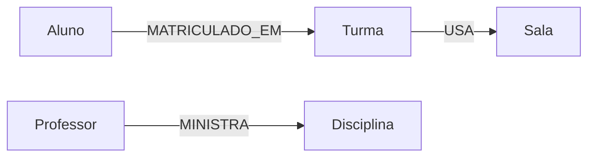
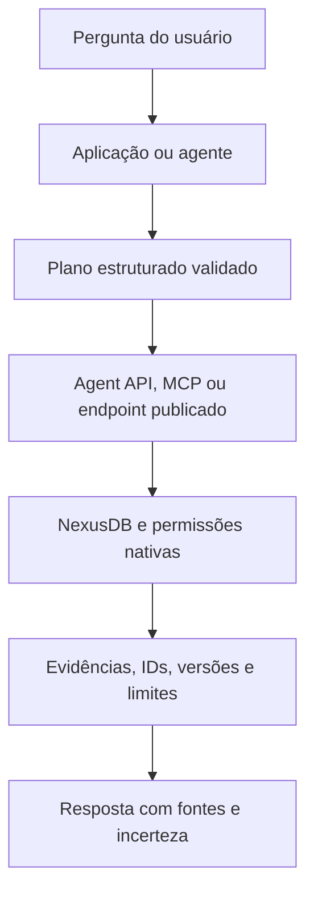
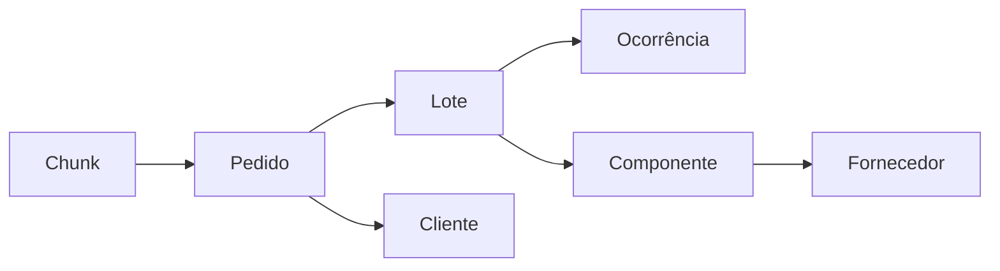
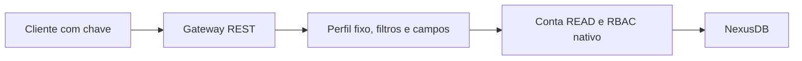

# NexusDB na prática

## Do primeiro grafo à integração com inteligência artificial

**Livro de uso e laboratório · edição de 18 de outubro de 2026 · português**

Base editorial: programas de exemplo, contratos HTTP, documentação e testes presentes nos checkouts locais do NexusDB, do cliente de terminal e da coleção `nexusDB-tests`. Este livro descreve a implementação disponível nesta edição; comentários antigos e propostas de interfaces são identificados quando divergem do servidor atual.

---

## Como estudar este livro

O percurso tem **três capítulos principais**. O primeiro ensina a instalar, conectar e construir um grafo. O segundo transforma os dados em aplicações e análises. O terceiro aborda operação, programação NPL e uma parte extensa de **integração com sistemas de IA: ferramentas, MCP, RAG e GraphRAG**.

Cada laboratório apresenta objetivo, requisitos, execução, observação esperada e limites. Os comandos de terminal usam PowerShell no Windows. Execute-os somente quando chegar ao exercício correspondente: vários programas criam bancos e escrevem dados. As demonstrações explicitamente isoladas criam seu próprio processo e diretório; os importadores e painéis conectados a uma URL usam o servidor informado.

Este trabalho não executou novamente todos os programas. Os exemplos foram inventariados e estudados estaticamente; resultados históricos de README ou relatórios não equivalem a uma homologação nesta edição. A integração NPL da etapa anterior passou em compilação, 114 testes de biblioteca, seis testes de integração e cinco testes Python; esse resultado tem aquele escopo, não o de todos os exemplos deste livro.

O [catálogo completo de programas](LIVRO_NEXUSDB_CATALOGO.md) acompanha o livro, com arquivos, funções/classes e opções de linha de comando encontradas nas fontes. Ele inclui também auxiliares e testes das aplicações, evitando confundir um módulo importável com um programa executável.

### Sumário

- [Capítulo 1 — Iniciante: construir e consultar o primeiro grafo](#capitulo-1)
- [Capítulo 2 — Intermediário: aplicações, algoritmos e dados temporais](#capitulo-2)
- [Capítulo 3 — Avançado: operação, NPL e integração com IA](#capitulo-3)
- [Apêndice A — Roteiros de estudo](#apendice-a)
- [Apêndice B — Diagnóstico e glossário](#apendice-b)
- [Apêndice C — Fontes e cobertura dos exemplos](#apendice-c)

### Convenções e diretórios

| Caminho local | Conteúdo utilizado |
|---|---|
| `E:\nexusdb` | Servidor Rust, exemplos, documentação e testes nativos |
| `E:\nexusdb-cli` | Cliente de terminal e arquivos SQL/Cypher de exemplo |
| `E:\nexusDB-tests` | Aplicações externas, importadores e experimentos complementares |

Os links do livro são relativos ao seu arquivo. Para compartilhar os exemplos externos, preserve a organização dos diretórios ou adapte seus caminhos. Não é necessário possuir todos os conjuntos de dados para começar: os laboratórios sintéticos oferecem um percurso independente deles.

<a id="capitulo-1"></a>

# Capítulo 1 — Iniciante: construir e consultar o primeiro grafo

## 1.1 Entender o que será armazenado

Um property graph representa entidades como nós e conexões como relacionamentos. Cada nó tem um identificador interno, um label e propriedades. Um relacionamento liga dois identificadores, tem um tipo e também pode possuir propriedades.

Na escola, um aluno se relaciona com uma turma. Na oficina, uma ordem de serviço se relaciona com veículo, peças e recursos. Em uma base documental, um trecho pode apontar para o pedido ao qual se refere. O modelo torna explícita a conexão que uma aplicação precisaria reconstruir a cada consulta.



Não confunda o identificador de negócio com o identificador interno. `PED-1042`, `OS004` e o código de um aeroporto pertencem ao domínio da aplicação. O número interno é usado por APIs de relacionamento e por algoritmos. Os exemplos robustos mantêm uma tabela de correspondência entre ambos.

O NexusDB desta edição é experimental. Oferece persistência apoiada em SQLite e uma linguagem Cypher-like, além de procedimentos e APIs estruturadas. Não presuma compatibilidade integral com PostgreSQL, Neo4j ou openCypher. Uma sintaxe familiar precisa ser confirmada no subconjunto implementado.

**Leitura de apoio:** [compatibilidade openCypher](Docs/OPENCYPHER_COMPATIBILITY.md) e [README do servidor](README.md).

## 1.2 Preparar uma instância de laboratório

Requisitos básicos: Rust/Cargo para compilar e Python para os clientes. Muitos exemplos usam somente a biblioteca padrão do Python; PyArrow, Streamlit e dependências científicas são necessidades de programas específicos.

No diretório do servidor:

```powershell
Set-Location E:\nexusdb
cargo build --bin nexusdb
```

O modo padrão não exige CUDA. Para os laboratórios de conhecimento e Phronesis, compile posteriormente com as features indicadas no capítulo avançado. Não é preciso habilitar todos os recursos para aprender CRUD.

Para criar um laboratório manual separado, use um diretório de dados e uma porta que não pertençam ao serviço instalado. O exemplo seguinte usa `17474`; verifique antes se a porta está livre e use um diretório novo para o primeiro bootstrap:

```powershell
$env:NEXUSDB_MODE = 'SINGLE'
$env:NEXUSDB_HTTP_ADDR = '127.0.0.1:17474'
$env:NEXUSDB_DATA_ROOT = 'E:\nexusDB-tests\EXAMPLE_LIVRO_RUNTIME\data'
$env:NEXUSDB_COMPUTE_BACKEND = 'CPU_SERIAL'
$credLivro = Get-Credential -UserName admin -Message 'Senha para o novo laboratório NexusDB'
$env:NEXUSDB_ADMIN_PASSWORD = $credLivro.GetNetworkCredential().Password
.\target\debug\nexusdb.exe run
```

A senha inicial precisa atender à política do servidor, incluindo pelo menos 12 caracteres. `NEXUSDB_ADMIN_PASSWORD` serve ao bootstrap de um cadastro novo; não redefine uma conta já existente. Deixe esse terminal aberto e use outro para os clientes. Ao concluir, encerre somente o processo desse laboratório.

O arquivo [nexusdb_single.conf](conf_examples/nexusdb_single.conf) mostra a configuração equivalente por arquivo. O executável aceita `run --config ARQUIVO`. Variáveis já presentes no ambiente têm precedência sobre o arquivo; evite manter uma opção antiga no ambiente e esperar que o arquivo a substitua.

**Resultado esperado:** o processo inicia no endereço escolhido e cria seus próprios arquivos de dados. Se a porta estiver ocupada, altere o endereço; não encerre o serviço existente para liberar a porta.

## 1.3 Autenticar e escolher o banco

A API nativa usa os cabeçalhos `X-User`, `X-Pass` e `X-Database`. Usuário e senha autenticam; o terceiro cabeçalho seleciona o banco. Uma chave Bearer do gateway REST não autentica automaticamente na API nativa.

No segundo terminal:

```powershell
$urlLivro = 'http://127.0.0.1:17474'
$credLivro = Get-Credential -UserName admin -Message 'Conta do laboratório'
$headersLivro = @{
    'X-User' = $credLivro.UserName
    'X-Pass' = $credLivro.GetNetworkCredential().Password
    'X-Database' = 'geo'
}
```

`geo` é a seleção padrão observada no parser atual; ajuste-a caso sua instalação use outro banco inicial. O administrador pode listar os bancos com `SHOW DATABASES`. Para criar um banco exclusivo pelo endpoint administrativo:

```powershell
$bodyLivro = @{ database = 'EXAMPLE_LIVRO' } | ConvertTo-Json
Invoke-RestMethod -Method Post -Uri "$urlLivro/db/admin/database/create" `
    -Headers $headersLivro -ContentType 'application/json' -Body $bodyLivro
$headersLivro['X-Database'] = 'EXAMPLE_LIVRO'
```

Execute a criação uma vez. Um erro de banco existente exige inspecionar o estado, não apagar dados para repetir o tutorial.

O [teste de autenticação](examples/authentication_test.py) lê `NEXUSDB_URL`, `NEXUSDB_USER`, `NEXUSDB_PASSWORD` e `NEXUSDB_DATABASE`. Ele inclui verificações negativas deliberadas. Para uma primeira leitura cotidiana, prefira uma consulta válida; não execute tentativas de senha errada em repetição, pois há política de bloqueio.

## 1.4 Criar um cliente HTTP pequeno e compreensível

O envelope Cypher contém `statements`, uma lista de objetos com `query`. Uma função PowerShell reduz repetição e, principalmente, verifica erros que podem aparecer dentro de uma resposta HTTP recebida com sucesso:

```powershell
function Invoke-LivroCypher {
    param([Parameter(Mandatory)][string]$Query)
    $payloadLivro = @{
        statements = @(@{ query = $Query })
    } | ConvertTo-Json -Depth 20
    $respostaLivro = Invoke-RestMethod -Method Post `
        -Uri "$urlLivro/db/data/cypher" -Headers $headersLivro `
        -ContentType 'application/json' -Body $payloadLivro
    if ($respostaLivro.status -in @('error', 'partial_error') -or $respostaLivro.errors) {
        throw ($respostaLivro | ConvertTo-Json -Depth 20)
    }
    $respostaLivro
}

Invoke-LivroCypher 'CALL db.stats();'
```

**O que observar:** `resultados`, eventuais metadados por instrução e `errors`. `partial_error` significa que parte do lote pode ter sido executada. Um lote de instruções não deve ser tratado como uma transação coletiva.

Para preservar metadados de certos `CALL`, use também `include_statement_results: true` no corpo. Esse recurso é empregado nos exemplos de conhecimento e nos adaptadores do gateway.

### O mesmo contrato em Python

O cliente abaixo usa apenas a biblioteca padrão. Ele lê o destino e a conta do ambiente e solicita a senha quando ela não foi fornecida. Salve-o como um arquivo local de estudo, fora de diretórios com dados privados:

```python
import getpass
import json
import os
import urllib.error
import urllib.request

url = os.environ.get('NEXUSDB_URL', 'http://127.0.0.1:17474').rstrip('/')
user = os.environ.get('NEXUSDB_USER', 'admin')
database = os.environ.get('NEXUSDB_DATABASE', 'EXAMPLE_LIVRO')
password = os.environ.get('NEXUSDB_PASSWORD') or getpass.getpass('Senha NexusDB: ')


def query(statement, parameters=None):
    payload = {'statements': [{
        'query': statement,
        'parameters': parameters or {},
    }]}
    request = urllib.request.Request(
        url + '/db/data/cypher',
        data=json.dumps(payload, ensure_ascii=False).encode('utf-8'),
        headers={
            'Content-Type': 'application/json',
            'X-User': user,
            'X-Pass': password,
            'X-Database': database,
        },
        method='POST',
    )
    try:
        with urllib.request.urlopen(request, timeout=30) as response:
            result = json.load(response)
    except urllib.error.HTTPError as error:
        raise RuntimeError(f'HTTP {error.code}; confira acesso e contrato') from None
    if result.get('errors') or result.get('status') in ('error', 'partial_error'):
        raise RuntimeError('O servidor informou erro; inspecione o resultado sem credenciais.')
    return result


print(json.dumps(query('CALL db.stats();'), ensure_ascii=False, indent=2))
```

Esse primeiro cliente não faz retries e não inicia um servidor. Em aplicações remotas, use HTTPS e controle o destino configurado. Ao adaptar a consulta, use parâmetros nas formas efetivamente aceitas pelo procedimento ou parser; a presença de `parameters` no envelope não torna toda construção textual suportada.

## 1.5 Primeiro nó, primeira consulta

O arquivo [exemplo.cypher](../nexusdb-cli/exemplos/exemplo.cypher) apresenta um percurso mínimo: estatísticas, criação, leitura e EXPLAIN. Adaptado ao nosso banco:

```powershell
Invoke-LivroCypher "CREATE (:PessoaTeste {nome:'Ana Livro',cidade:'Niteroi',origem:'livro'});"
Invoke-LivroCypher 'MATCH (p:PessoaTeste) RETURN p LIMIT 10;'
Invoke-LivroCypher "EXPLAIN MATCH (p:PessoaTeste) WHERE p.cidade = 'Niteroi' RETURN p LIMIT 10;"
```

`CREATE` não é uma importação idempotente: repeti-lo pode produzir outro nó. Observe o identificador retornado e não suponha que será igual ao identificador de outra execução.

`EXPLAIN` ajuda a entender a estratégia escolhida. Ele não comprova o tempo que a consulta levará e não substitui executar uma consulta pequena com seus dados. Ao usar `LIMIT`, lembre que o limite de linhas não garante, sozinho, pouco trabalho de leitura ou de cálculo.

O [exemplo.sql](../nexusdb-cli/exemplos/exemplo.sql) contém `SELECT * FROM PessoaTeste LIMIT 10` e `SHOW DATABASES`. Essa interface é SQL-like: o exemplo não implica um motor SQL relacional completo.

## 1.6 Usar o cliente de terminal

Compile o cliente em seu próprio repositório:

```powershell
Set-Location E:\nexusdb-cli
cargo build --release
.\target\release\nexusdb-cli.exe --host http://127.0.0.1:17474 `
    --user admin --database EXAMPLE_LIVRO
```

A senha é solicitada sem eco. Termine as instruções com `;`. Use `\?` para ajuda, `\q` para sair, `\conninfo` para conferir a conexão e `\c EXAMPLE_LIVRO` para escolher o banco. `\stats` solicita estatísticas e `\explain` ajuda a examinar consultas.

O cliente também aceita `-c` para uma consulta e `-f` para um arquivo. Revise arquivos antes da execução: [admin.sql](../nexusdb-cli/exemplos/admin.sql) demonstra operações administrativas, e não deve ser executado como se fosse apenas uma leitura.

**Exercício:** conecte pelo CLI, liste as pessoas criadas e execute a mesma leitura por HTTP. Compare os envelopes, não apenas a apresentação tabular. O protocolo e o conteúdo do banco continuam sendo os mesmos.

## 1.7 Criar relacionamentos com importação em lotes

Para aplicações, as APIs bulk evitam o padrão de uma requisição por registro. As linhas de nós usam `key`, `label` e `properties`. O `key` permite correlacionar a resposta; não o trate como garantia geral de unicidade persistente.

```powershell
$nosLivro = @{
    rows = @(
        @{ key='aluno-1'; label='Aluno'; properties=@{nome='Ana'; codigo='A001'} },
        @{ key='turma-1'; label='Turma'; properties=@{nome='Turma Demo'; codigo='T001'} }
    )
} | ConvertTo-Json -Depth 10
$criadosLivro = Invoke-RestMethod -Method Post -Uri "$urlLivro/db/data/node/bulk" `
    -Headers $headersLivro -ContentType 'application/json' -Body $nosLivro
if ($criadosLivro.errors -or $criadosLivro.status -in @('error','partial_error')) {
    throw ($criadosLivro | ConvertTo-Json -Depth 20)
}
$idsLivro = @{}
foreach ($linhaLivro in $criadosLivro.resultados) { $idsLivro[$linhaLivro.key] = $linhaLivro.id }
if (-not $idsLivro.ContainsKey('aluno-1') -or -not $idsLivro.ContainsKey('turma-1')) {
    throw 'A carga não retornou os dois IDs esperados.'
}
$arestasLivro = @{
    rows = @(@{ key='matricula-1'; from=$idsLivro['aluno-1']; to=$idsLivro['turma-1'];
                type='MATRICULADO_EM'; properties=@{ano=2026} })
} | ConvertTo-Json -Depth 10
Invoke-RestMethod -Method Post -Uri "$urlLivro/db/data/relationship/bulk" `
    -Headers $headersLivro -ContentType 'application/json' -Body $arestasLivro
```

Depois consulte:

```cypher
MATCH (a:Aluno)-[r:MATRICULADO_EM]->(t:Turma) RETURN a,t,r LIMIT 10;
```

Uma carga de nós seguida por uma carga de relações pode ficar parcial. Se a segunda etapa falhar, conserve os IDs e o relatório da primeira. Não repita toda a carga sem examinar o banco.

## 1.8 Aprender permissões antes de conectar aplicações

Um administrador pode criar uma conta de leitura e conceder acesso ao banco. Para senhas, prefira os comandos interativos `\password` e `\password-reset` do CLI ou uma requisição administrativa preparada em memória. Evite gravar segredos em arquivos SQL e argumentos de processos.

Os comandos de concessão têm a forma:

```sql
GRANT READ ON DATABASE EXAMPLE_LIVRO TO leitor_livro;
SHOW GRANTS FOR leitor_livro;
REVOKE WRITE ON DATABASE EXAMPLE_LIVRO FROM leitor_livro;
```

READ, WRITE e ADMIN são direitos distintos. WRITE não deve ser presumido como READ; OWNER e SUPERUSER também possuem direitos implícitos que uma revogação de concessão explícita não remove. O catálogo de usuários e grants é local a cada nó nesta implementação.

**Exercício final do capítulo:** consulte o grafo com uma conta READ e confirme que a aplicação não precisa de uma conta administrativa para mostrar resultados. Use um banco exclusivo, não dados pessoais ou de produção.

**Fontes do capítulo:** [usuários e grants](Docs/SQL_USERS_AND_GRANTS.md), [autenticação](examples/README_AUTHENTICATION.md), [cliente de terminal](../nexusdb-cli/README.md) e [CRUD acadêmico](examples/crud_academico-Example/README.md).

<a id="capitulo-2"></a>

# Capítulo 2 — Intermediário: aplicações, algoritmos e dados temporais

## 2.1 Escolher a família de exemplo certa

Os programas ensinam problemas diferentes. Comece pelo caso que tem uma relação clara com seu domínio e depois compare os mecanismos compartilhados.

| Família | Pergunta didática | Onde o cálculo principal acontece |
|---|---|---|
| Escola | Como organizar entidades, restrições e horários? | Persistência NexusDB; planejamento da aplicação em Python |
| Oficina | Como explicar prioridades diante de recursos escassos? | Python offline; ranking Phronesis quando integrado |
| Leitos | Como comparar alocação e disponibilidade? | Simulador e otimização locais em Python |
| Supply Chain | Quais produtos e pedidos dependem de um fornecedor? | Consultas NexusDB e análises do painel |
| OpenFlights | Como separar caminho estrutural de itinerário? | Algoritmos nativos e planejamento semântico na aplicação |
| BioGRID | Como explorar interações e evidências experimentais? | Grafo persistido e consultas/algoritmos do servidor |
| Grafo urbano | Quais serviços estão próximos de quais pontos? | Construção geoespacial Python e persistência/análise NexusDB |
| Temporal | O que era válido e o que era conhecido em cada momento? | Histórico e projeções nativas |

## 2.2 Laboratório escolar: CRUD, importação e planejamento

**Programa:** [crud_academico/app.py](examples/crud_academico-Example/app.py). Usa Python 3.10+ e biblioteca padrão; não precisa de Streamlit.

```powershell
Set-Location E:\nexusdb
python examples/crud_academico-Example/app.py --url http://127.0.0.1:17474 `
    --user admin --database ACADEMICO_DEMO --create
```

A criação é explícita e deve falhar se o banco já existir. Para reabrir o banco depois, execute sem `--create`. O painel usa a porta 8765 por padrão.

Na interface, importe a configuração escolar somente em banco vazio. O conjunto entregue contém 18 salas, 14 turmas, 343 alunos, 18 professores e 15 disciplinas; a documentação registra 424 nós antes das aulas e 477 relacionamentos. Esses números pertencem àquele arquivo de demonstração, não a uma capacidade máxima do NexusDB.

Estude os três arquivos separadamente:

- `app.py`: comunicação HTTP, interface e carga;
- `planning.py`: compatibilidade professor/nível, turnos, slots e GRASP com busca local;
- `optimization.py`: objetivos, análise de recursos e comparação de propostas.

Escolha **Gerar sugestão sem salvar** antes de persistir um planejamento. Verifique restrições duras, como conflito de professor e capacidade de sala, antes de comparar preferências. Uma pontuação melhor não autoriza violar uma restrição obrigatória.

O exemplo documenta 318 aulas produzidas no conjunto determinístico de referência. Ao alterar recursos ou horários, pendências são um resultado possível e devem ser explicadas. A importação usa chamadas bulk separadas; não é uma transação única.

**Exercício:** remova a disponibilidade de um professor no conjunto de estudo e observe se a proposta explica o conflito. Compare solução viável, solução incompleta e preferência de qualidade. Consulte também os README de [GRASP](examples/crud_academico-Example/README_GRASP.md), [multiobjetivo](examples/crud_academico-Example/README_MULTI_OBJETIVO.md) e [importação](examples/crud_academico-Example/README_IMPORTACAO.md).

## 2.3 Oficina: ranking, explicação e persistência têm papéis diferentes

Existem duas famílias preservadas: [oficina_mecanica_example](examples/oficina_mecanica_example/README.md) e [nexusdb_oficina_comercial](examples/nexusdb_oficina_comercial/README.md). Comece pelo modo offline, que não exige servidor:

```powershell
Set-Location E:\nexusdb\examples\oficina_mecanica_example
python app.py --mode offline --port 8899
```

Abra o painel local e examine uma ordem bloqueada por falta de peça. Registre a chegada de um kit, altere a disponibilidade de um mecânico e exporte um relatório. O caso torna visíveis três etapas: elegibilidade, ranking e alocação de recursos.

O modo offline calcula em Python. A interface não deve ser apresentada como evidência de Phronesis ou de BFS nativo. Mesmo no modo gateway, o ranking pode ser nativo enquanto a alocação continua gulosa em Python; alterações de estoque e conclusão no painel permanecem locais.

Para estudar uma carga real isolada:

```powershell
python seed_nexusdb.py --repo E:\nexusdb `
    --server E:\nexusdb\target\debug\nexusdb.exe --output .\saida_carga
```

O banco de demonstração é `EXAMPLE_OFICINA_INTELIGENTE`. Para a preparação na instância permanente, use o roteiro específico [API e gateway da oficina](examples/oficina_mecanica_example/README_API_GATEWAY.md). `api_setup.py`, `bootstrap_api_oficina.py`, `secure_store.py` e `iniciar_api_oficina.bat` têm funções de provisionamento: não são apenas visualizadores.

A documentação mais nova inclui perfis READ e um banco separado para Phronesis. Essa orientação prevalece sobre avisos históricos de que nenhum caminho nativo havia sido confirmado. Ainda assim, o modo legado `/db/query/call` permanece dependente de contrato e não deve ser adotado como API universal.

**Exercício:** desenhe uma tabela com a origem de cada informação do painel: dataset local, NexusDB, Phronesis, simulação de estoque e histórico JSONL. Essa tabela evita vender uma simulação como sistema transacional completo.

## 2.4 Leitos hospitalares: um laboratório de otimização local

Para persistência hospitalar e recuperação de evidências no servidor real, veja também o [hospital longitudinal](examples/hospital_longitudinal-Example/README.md): 20 pacientes fictícios, três atendimentos por paciente, fontes versionadas, gabarito separado e testes de histórico/ACL. Esse laboratório complementa o painel local de otimização e cita o artigo *Synthetic Hospital* como inspiração metodológica.

Os programas de [leitos_hospitais](examples/leitos_hospitais-Example/README_OTIMIZACAO.md) usam dados fictícios e métodos locais. O painel não é, por si só, um cliente de persistência NexusDB.

```powershell
Set-Location E:\nexusdb\examples\leitos_hospitais-Example
python app.py --no-browser
python benchmark.py --output benchmark_livro.json
```

`app.py` aceita `--dataset`, `--port` e `--no-browser`. Verifique se o ZIP esperado está presente; se necessário, gere os dados após revisar `gerar_hsja_simulado.py`. O gerador possui decisões de caminho próprias; não suponha que todo programa aceita `--output`.

O conjunto descreve 310 leitos, 1.470 profissionais fictícios e 20 mil atendimentos. Atendimento não equivale a internação. Os horários e ciclos são simulados; escalas não foram validadas como dimensionamento clínico. O arquivo [LEIA_ME](examples/leitos_hospitais-Example/LEIA_ME.md) explica as chaves e limitações.

**Como interpretar:** compare viabilidade, benefício calculado, tempo de execução e violações. Uma melhoria no objetivo sintético não demonstra benefício clínico. Para conectar esse caso ao NexusDB, seria necessário criar um importador correspondente às entidades e relações, validar IDs e implementar escrita/autorização; o painel local não realiza essa integração implicitamente.

## 2.5 Algoritmos de grafo com interpretação correta

Comece por estatísticas e grau; só depois use PageRank, componentes e caminhos. Os exemplos de rotas aéreas e BioGRID mostram por que a semântica importa.

```cypher
CALL graph.statistics();
CALL algo.degree();
CALL algo.pageRank(20);
CALL algo.connectedComponents();
```

Para caminhos, substitua os identificadores pelos valores efetivamente retornados no seu banco:

```cypher
CALL algo.shortestPath(1, 3);
CALL graph.expand(1, 2);
```

Não execute a segunda dupla esperando IDs fixos do tutorial. Primeiro descubra o nó que representa a entidade desejada. Não confunda `graph.shortest_path` da Agent API com o nome Cypher `algo.shortestPath`: são interfaces diferentes para capacidades relacionadas.

| Medida | O que informa | O que exige interpretação adicional |
|---|---|---|
| Grau | Quantidade de conexões conforme a semântica implementada | Influência social, criticidade operacional |
| PageRank | Ranking estrutural dependente de direção e parâmetros | Valor de negócio ou causalidade |
| Componentes | Conectividade entre grupos | Comunidades com significado substantivo |
| Menor caminho | Percurso mínimo segundo a operação selecionada | Custo, tempo e validade do percurso no domínio |

A representação CSR é um derivado para cálculo. O grafo persistido e sua revisão continuam sendo a referência dos dados. Ao ler `execution`, confira o backend efetivo e as etapas de materialização; não deduza uso de GPU apenas porque a consulta foi rápida.

## 2.6 OpenFlights: conexão de grafo não é bilhete de avião

**Arquivos externos:** [importador](../nexusDB-tests/Openfights/nexusdb_airroutes_import/README.md) e [AirRoute Resilience](../nexusDB-tests/Openfights/nexusdb_airroute_resilience_v1/README.md). O diretório local chama-se `Openfights`, embora o dataset seja OpenFlights.

Inspecione a carga antes de escrever:

```powershell
Set-Location E:\nexusDB-tests\Openfights\nexusdb_airroutes_import
python import_openflights_nexusdb.py --help
```

O importador aceita `--folder`, `--database`, `--batch-size`, `--route-limit` e `--dry-run`. Forneça os arquivos locais, as credenciais e um banco de demonstração. O dashboard é executado a partir de sua pasta:

```powershell
Set-Location E:\nexusDB-tests\Openfights\nexusdb_airroute_resilience_v1
python -m pip install -r requirements.txt
python -m streamlit run app.py
```

Compare duas perguntas. O menor caminho no grafo heterogêneo pode passar por nós de companhia, país ou rota. Um itinerário de voo precisa seguir conexões `Airport → Airport` derivadas da semântica de `Route`. O planejador multi-hop do painel separa essas interpretações.

O pré-filtro espacial usa coordenadas e a aplicação pode refinar candidatos com Haversine. A existência de uma aresta não confirma disponibilidade, frequência, preço ou possibilidade real de comprar conexões.

## 2.7 Supply Chain: seguir dependências e explicar risco

O [importador de Supply Chain](../nexusDB-tests/SuplyChain-Ford-Kaggle/README.md) transforma CSV em nós e relacionamentos. O [painel](../nexusDB-tests/SuplyChain-Ford-Kaggle/supply_chain_demo/README.md) acrescenta impacto, risco, alternativas e caminhos afetados.

```powershell
Set-Location E:\nexusDB-tests\SuplyChain-Ford-Kaggle
python import_supply_chain_nexusdb.py --help
python -m streamlit run supply_chain_demo/app.py
```

O importador possui `--csv`, `--limit`, `--batch-size`, `--timeout` e seleção de banco. Execute-o somente com arquivo e destino revisados. No painel, conecte uma vez e então explore o grafo carregado. A aplicação faz um pre-flight autenticado e interrompe a carga se ele falhar; alterar filtros não deve provocar uma sequência de tentativas de senha incorreta.

Uma cadeia de explicação útil é `Fornecedor → Produto → Pedido → Cliente`. A interpretação de risco precisa indicar quais dependências foram observadas e como o score foi decomposto. Um fornecedor alternativo presente no grafo não comprova capacidade, estoque, homologação, prazo ou substituição industrial.

**Exercício:** escolha um fornecedor, liste produtos e pedidos relacionados e descreva duas informações que faltam para transformar a análise em um plano operacional de continuidade.

## 2.8 BioGRID: conservar a evidência da relação

Use o [importador BioGRID](../nexusDB-tests/BioGrid/nexusdb_biogrid_importer/README.md) e o [Research Explorer](../nexusDB-tests/BioGrid/BioGRID-Explorer/README.md) como estudo de um grafo científico. O importador aceita arquivo local, tamanho de lote e seleção de organismos; `--all-organisms` amplia a carga e não deve ser habilitado por hábito.

```powershell
Set-Location E:\nexusDB-tests\BioGrid\nexusdb_biogrid_importer
python import_biogrid_nexusdb.py --help
Set-Location E:\nexusDB-tests\BioGrid\BioGRID-Explorer
python -m pip install -r requirements.txt
python -m streamlit run app.py
```

O Explorer possui busca de genes humanos, evidências, camadas experimentais, expansão CSR, centralidade e caminhos. O valor analítico depende da cobertura e da proveniência da importação. Uma base parcialmente carregada pode alterar componentes e rankings.

A relação `INTERACTS_WITH` carrega propriedades de evidência. A presença de uma interação experimental não equivale a uma conclusão clínica. O painel de predição é demonstrativo de schema; não fabrica previsões. Antes de comparar métodos, confirme organismo, tipo de experimento, identificadores e quantidade realmente importada.

## 2.9 Grafo urbano e espacial: declarar unidades faz parte da consulta

A coleção [geospatial-urban-graph](../nexusDB-tests/geospatial-urban-graph/README.md) separa geocodificação, construção de relações de proximidade e persistência. O caminho sintético evita depender de downloads para aprender o pipeline.

```powershell
Set-Location E:\nexusDB-tests\geospatial-urban-graph
python -m pip install -r requirements.txt
python demo.py --help
python demo.py
```

O último comando importa dados no servidor configurado; defina credenciais e confirme que o destino é um laboratório. O script também aceita `--geocode-csv`, `--poi-csv` e `--radius-m`. Geocodificação real e download de POIs são etapas separadas e podem envolver conjuntos grandes ou serviços remotos.

`download_niteroi_pois.py` é um coletor explícito; não é necessário para a fixture sintética. `visualize_urban_graph.py` gera figuras e `interactive_urban_map.py` abre a exploração interativa. Não reutilize automaticamente opções de segurança TLS permissivas de um experimento.

O filtro espacial do NexusDB opera conforme a geometria e o CRS armazenados. Um raio de 1.200 só significa metros quando o sistema de coordenadas e a implementação usada sustentam essa unidade. Proximidade euclidiana não equivale a acesso por ruas, tempo de ambulância ou rota de transporte.

Para estudar o motor com dados e processo isolados:

```powershell
Set-Location E:\nexusdb
python examples/spatial_temporal_demo.py --headless --output target/livro-spatial
```

**Leitura:** [integração espacial](Docs/SPATIAL_INTEGRATION.md).

## 2.10 Temporalidade: distinguir validade e conhecimento

Um registro pode ser válido no mundo representado em uma data e só ser conhecido pelo banco em outra. A correção retroativa de uma transferência hospitalar ilustra a diferença. Uma consulta ao passado usando o conhecimento atual pode devolver algo diferente daquilo que se sabia na época.

O histórico é uma opção por banco. Não é ativado automaticamente para toda a instalação. Intervalos de validade usam a convenção `[início,fim)`: incluem o início e excluem o fim. Use UTC com precisão adequada e conserve o watermark real devolvido pelo journal.

O [exemplo Rust hospitalar](examples/README_TEMPORAL_DEMO.md) é uma entrada direta:

```powershell
Set-Location E:\nexusdb
cargo run --example temporal_hospital_demo -- --patients 250 --seed 42 `
    --output E:\nexusDB-tests\livro-temporal-rust
```

Ele cria uma instância isolada e verifica caminhos temporais, janelas, correção retroativa, evidências e recarga. Os vetores são sintéticos; o objetivo não é medir compreensão semântica.

Para uma visualização offline em HTML, use a [versão Python](examples/README_TEMPORAL_PYTHON.md):

```powershell
python -m pip install pyarrow
python examples/temporal_graph_demo.py --patients 50 --seed 42 `
    --output E:\nexusDB-tests\livro-temporal-python
```

Abra `temporal_graph.html` no diretório `run-...` gerado. Compare o estado conhecido antes e depois da correção, depois leia `report.json`. Alterar o slider do HTML é exploração local; as verificações do relatório foram executadas pelo programa contra o banco.

`graph.earliestArrival` minimiza chegada, com possibilidade de espera. `graph.temporalBfs` minimiza saltos respeitando cronologia. Um caminho estrutural obtido sobre uma janela temporal não implica, por si só, que todos os passos possam ser percorridos cronologicamente.

## 2.11 Laboratório temporal de mercados

[crypto_temporal_lab.py](examples/README_CRYPTO_TEMPORAL_LAB.md) usa Python padrão, Tkinter e um servidor NexusDB isolado:

```powershell
Set-Location E:\nexusdb
python examples/crypto_temporal_lab.py --headless --scenario coordinated `
    --seed 42 --output target/livro-mercado
python examples/crypto_temporal_lab.py --scenario independent
```

Na interface, compare concentração de volume, sincronismo e camadas. Os cenários `whale` e `synchronized_small` são controles úteis: uma carteira dominante e um grupo sincronizado de baixo volume podem produzir sinais diferentes.

O banco persiste eventos e entrega a projeção; o Python calcula HHI, entropia, participação, similaridade dos histogramas e outros indicadores. Os dados e preços são simulados. O teste exploratório não prova coordenação, intenção ou causalidade, nem permite identificar pessoas por endereços.

Se importar CSV próprio, normalize antes os eventos e o nocional monetário. O formato espera `event_id`, timestamp com fuso, ativo, endpoints, trader, lado e `usd_cents`. Não duplique as duas pernas de um swap como dois eventos independentes do mesmo volume.

## 2.12 Arrow: ler por lotes sem acesso ao disco do servidor

[arrow_client.py](examples/arrow_client.py) é uma biblioteca de funções, não uma interface com argumentos. `export_properties` solicita uma exportação autenticada por `graph.exportArrow($request)`; `batches` lê RecordBatches por `/db/data/arrow/download`.

Criar a exportação exige WRITE; ler o artefato exige READ. A função mantém apenas o lote atual no cliente, mas o custo de preparar a exportação no servidor continua existindo. Não se trata de abrir um caminho arbitrário no filesystem remoto.

A demonstração temporal Python já exercita esse cliente. Para criar uma aplicação própria, reutilize suas funções e forneça o mapa de requisição documentado em [armazenamento particionado](Docs/PARTITIONED_STORAGE.md), em vez de inventar campos de exportação.

**Projeto do capítulo:** escolha escola, supply chain ou rotas. Importe uma base pequena, confira contagens, consulte uma relação, calcule uma medida estrutural e escreva uma interpretação com duas limitações do modelo. Preserve parâmetros e relatório para outra pessoa repetir.

<a id="capitulo-3"></a>

# Capítulo 3 — Avançado: operação, NPL e integração com IA

## 3.1 Planejamento, recursos e telemetria

O caminho de execução reúne autenticação, autorização, escolha do banco, consulta nativa, recursos e resposta. Antes de aumentar paralelismo, identifique onde o tempo e a memória estão sendo consumidos.

No planejamento de `MATCH`, o GRASP do núcleo escolhe entre alternativas compatíveis com a AST implementada. Isso é diferente do GRASP usado pelo programa escolar para montar horários. O nome do método é compartilhado; os problemas e os executores são distintos.

Leia `optimizer.physical_plan`, `nodes_visited` e `edges_visited` nas consultas apropriadas. `PROFILE` não deve ser presumido como uma execução integral instrumentada: a documentação atual conserva semântica de explicação para essa interface.

As configurações de compute incluem `AUTO`, `CPU_SERIAL`, `CPU_PARALLEL` e `CUDA`. CUDA é opcional e depende de build, biblioteca e dispositivo. O servidor informa backend solicitado, backend efetivo, motivo e fallback.

```powershell
$env:NEXUSDB_COMPUTE_BACKEND = 'CPU_PARALLEL'
$env:NEXUSDB_COMPUTE_THREADS = '4'
$env:NEXUSDB_COMPUTE_MAX_JOBS = '2'
$env:NEXUSDB_COMPUTE_MEMORY_MB = '256'
```

Defina as opções antes de iniciar a instância de estudo. Os valores são um exemplo de configuração, não uma recomendação de dimensionamento universal. As reservas são estimativas de estruturas gerenciadas; não constituem teto rígido para toda a RAM do processo.

[calibrate_compute.rs](examples/calibrate_compute.rs), [calibração adaptativa](Docs/ADAPTIVE_RUNTIME.md) e [runtime de consultas](Docs/QUERY_RUNTIME.md) aprofundam seleção e custos. Não interprete uma rodada local como prova de aceleração geral.

## 3.2 Out-of-core, checkpoints e limites de escala

Snapshots CSR e armazenamento particionado permitem estudar leitura em disco, integridade e exportação sem tratar todo derivado como uma estrutura que deve permanecer na RAM. O snapshot possui uma revisão e não se atualiza automaticamente com novas escritas.

O programa [phase9_validation.py](examples/phase9_validation.py) requer PyArrow e psutil. Seu argumento `--binary` é obrigatório; examine o código e a [documentação da fase 9](Docs/PHASE9_VALIDATION.md) para fornecer o executável de validação correto. `--server` é um argumento separado. Não substitua os dois automaticamente pelo mesmo binário.

O teste cria um data root novo e registra verificações. Ele não demonstra bilhões de arestas, throughput NVMe ou escalabilidade distribuída apenas por utilizar arquivos em disco.

Antes de um benchmark, registre dataset, revisão, build, hardware, seed, aquecimento, caches, concorrência, rejeições e duração por etapa. Tempo HTTP inclui autenticação, serialização e rede; não é o tempo puro do kernel.

## 3.3 HA, senhas e recuperação operacional

Os arquivos `node1_nexusdb.conf`, `node2_nexusdb.conf` e `node3_nexusdb.conf` demonstram topologia de múltiplos nós. Use [instalação de nós e serviço](Docs/INSTALACAO_SERVICO_NOS_REDE.md) para entender portas, diretórios e configuração. O teste legado `test_funcoes_rust/src/bin/test_ha_v22.rs` aparece no catálogo como experimento separado.

HA nesta edição é experimental; não equivale a um protocolo Raft comprovado. O catálogo de usuários/grants é local e precisa de tratamento em cada nó. Backups de dados não devem ser presumidos como backup de credenciais e de toda a configuração operacional.

Os programas `reset_admin_password.rs`, `reset_admin_password.ps1` e `password_security_validation.py` têm impacto administrativo. A validação de senhas usa instância descartável; os utilitários de recuperação exigem ler [política de senhas](Docs/PASSWORD_SECURITY.md) e conferir o diretório alvo. Não use bootstrap como substituto de um procedimento de recuperação.

Esse é um bom momento para distinguir três estados: arquivo persistido, estado visível em memória e informação confirmada ao cliente. Um retry de escrita sem idempotência pode duplicar um efeito que já ocorreu, mesmo quando o cliente não recebeu a resposta.

## 3.4 NPL/pg: registrar e chamar uma função

A integração NPL expõe `POST /db/npl`. Seu corpo usa `operation`; não é o mesmo envelope do endpoint Cypher. A linguagem implementa funções procedurais restritas, com condições, repetições e um host de leitura. Não é compatibilidade completa com PL/pgSQL.

No laboratório do primeiro capítulo, registre uma função simples:

```powershell
$registroNplLivro = @{
    operation = 'register'
    name = 'dobro_livro'
    source = 'CREATE FUNCTION dobro_livro(x INTEGER) RETURNS INTEGER BEGIN RETURN x * 2; END;'
} | ConvertTo-Json
Invoke-RestMethod -Method Post -Uri "$urlLivro/db/npl" `
    -Headers $headersLivro -ContentType 'application/json' -Body $registroNplLivro

$chamadaNplLivro = @{ operation='call'; query='CALL dobro_livro(21);' } | ConvertTo-Json
Invoke-RestMethod -Method Post -Uri "$urlLivro/db/npl" `
    -Headers $headersLivro -ContentType 'application/json' -Body $chamadaNplLivro
```

O valor esperado é 42 dentro de `resultados`. Registrar exige WRITE; chamar exige READ e, na política atual, ser proprietário da rotina. Uma conta não pode substituir silenciosamente uma rotina de outro proprietário.

Para executar leitura parametrizada diretamente pelo adaptador:

```powershell
$consultaNplLivro = @{
    operation = 'execute_cypher'
    query = 'MATCH (p:PessoaTeste) WHERE p.cidade = $cidade RETURN p LIMIT 10'
    parameters = @{ cidade='Niteroi' }
} | ConvertTo-Json -Depth 10
Invoke-RestMethod -Method Post -Uri "$urlLivro/db/npl" `
    -Headers $headersLivro -ContentType 'application/json' -Body $consultaNplLivro
```

O subconjunto aceito é estreito: `MATCH` de um label, igualdade opcional com parâmetro e retorno do alias, com limite. Ele não encaminha qualquer Cypher arbitrário. O arquivo [execute_inside.npl](tools/npl_v015/examples/execute_inside.npl) demonstra `EXECUTE CYPHER ... USING ... INTO` dentro de uma rotina; a resposta textual contém JSON que o cliente pode interpretar.

`memory_stats` exige ADMIN. As variáveis `NEXUSDB_NPL_GLOBAL_MEMORY_BYTES`, `NEXUSDB_NPL_DATABASE_MEMORY_BYTES`, `NEXUSDB_NPL_QUERY_MEMORY_BYTES` e `NEXUSDB_NPL_RESULT_MEMORY_BYTES` controlam reservas e resultado. O arquivo [memory_limits.ps1](tools/npl_v015/examples/memory_limits.ps1) exemplifica os valores.

As reservas não medem todo o RSS, e a materialização pode ocorrer antes da verificação final de bytes. O catálogo de rotinas é JSON local e global ao processo. Cache HOT/WARM/COLD e coordenador estão disponíveis como bibliotecas experimentais, separados do caminho automático das consultas. `begin`, `commit`, `rollback` e escrita Cypher NPL permanecem recusados. Veja [integração NPL](tools/npl_v015/README.md).

## 3.5 Análise científica com a família MGA

O pacote [MGA](examples/Advanced-Examples/nexusdb_mga/README.md) é uma biblioteca Python externa ao núcleo Rust. Comece pelo exemplo pequeno e aumente a dificuldade gradualmente:

```powershell
Set-Location E:\nexusdb\examples\Advanced-Examples\nexusdb_mga
python -m pip install -r requirements.txt
python demo.py --n 150 --k 6 --seed 42 --output resultados_livro
python demo_v06.py --quick --output resultados_livro_v06
python demo_v09.py --output datasets_livro_v09
```

| Programa | Tema principal |
|---|---|
| `demo.py` | PCA, agrupamento, anomalias e grafos de similaridade |
| `demo_v02.py` | Estatística e módulos científicos adicionais |
| `demo_v03.py` | Repetições, bootstrap e comparações pareadas |
| `demo_v04.py` | Bases independentes e robustez |
| `demo_v05.py` | Perturbações, diagnósticos e estabilidade |
| `demo_v06.py` | Escalabilidade em subprocessos e RSS |
| `demo_v07.py` | Adaptador de benchmark remoto por contrato |
| `demo_v08.py` | Gerenciamento de datasets e checksums |
| `demo_v09.py` | Importadores acadêmicos e propriedades |

Os módulos `analytics`, `statistics`, `learning`, `robustness`, `validation`, `datasets` e os demais auxiliares estão relacionados no catálogo. O diretório `nexusdb_mga_v09_demo` contém fixtures e exports, não outro servidor NexusDB.

A comparação remota v0.7 exige contrato confirmado; o JSON de exemplo não cria rotas no servidor. Backends indisponíveis precisam continuar indisponíveis no relatório, sem simular aceleração. Os experimentos locais em NetworkX/scikit-learn não são benchmarks do núcleo NexusDB.

A coleção externa [BMSSP-Dijkstra](../nexusDB-tests/BMSSP-Dijkstra/shortest_paths.py) também é didática e local. Os programas `grafos.py`, `grafos2.py` e `bmssp_snap_dimacs.py` exploram caminhos e datasets. O README contém afirmações históricas de eficiência; esta edição não as adota como desempenho comprovado. Verifique equivalência de resultados e meça antes de concluir ganho.

## 3.6 Integração com IA: definir a fronteira de responsabilidade

Uma arquitetura útil permite que o modelo escolha uma ferramenta e explique resultados, enquanto o banco continua executando consultas e algoritmos determinísticos com autorização.



Não envie uma saída textual de LLM diretamente para um executor de código ou para Cypher sem contrato. Os dados recuperados também podem conter instruções maliciosas. A aplicação precisa tratá-los como conteúdo não confiável, separado das instruções do sistema.

O pacote `nexusdb_ai-Example/core.py` ilustra planos JSON com allowlists de tipos e relações. Seu `HashEmbedding` é uma baseline lexical determinística; seu `VectorIndex` é uma busca exata em memória. Essas classes não devem ser apresentadas como HNSW do servidor ou como um modelo semântico treinado.

## 3.7 Agent Tools: descobrir antes de chamar

A Agent API oferece descoberta e execução de ferramentas de leitura. O cliente oficial do exemplo pede senha sem eco ou lê `NEXUSDB_TEST_PASSWORD`:

```powershell
Set-Location E:\nexusdb
python examples/agent-tools-Example/client.py --url http://127.0.0.1:17474 `
    --user leitor_livro --database EXAMPLE_LIVRO
python examples/agent-tools-Example/client.py --url http://127.0.0.1:17474 `
    --user leitor_livro --database EXAMPLE_LIVRO --tool database.stats
```

A conta deve existir e ter READ. O primeiro comando descobre ferramentas e schemas; não cria o banco. A execução usa `POST /agent/tool/{nome}` e um corpo como:

```json
{
  "database": "EXAMPLE_LIVRO",
  "input": {"source": 1, "target": 3, "directed": false},
  "budget": {"timeout_ms": 5000, "max_result_rows": 100}
}
```

Esse corpo corresponde a `graph.shortest_path`; substitua os IDs. Um orçamento do cliente pode reduzir os limites do servidor, mas não ampliá-los. Falha de admissão não significa ausência de dados.

As ferramentas incluem estatísticas, schema, BFS, vizinhos, caminhos, PageRank, busca vetorial e proximidade espacial. Descubra o schema real, em vez de inferir campos pelo nome. Campos extras são rejeitados.

Os três programas de [Agent-Examples](../nexusDB-tests/Agent-Examples/README.md) complementam o estudo: smoke/centralidade, validação de caminho e isolamento, e benchmark vetorial/espacial. Eles se conectam ao servidor escolhido; o vetor precisa ter a dimensão do índice e os IDs precisam existir.

Para comparar executor nativo e wrapper em processos de teste:

```powershell
cargo build --release --example agent_tools_bench
python examples/agent-tools-Example/benchmark.py
```

O resultado não mede HTTP nem LLM. Leia o método antes de interpretar a diferença de tempos.

## 3.8 MCP nativo: usar a descoberta padronizada de ferramentas

O [manual prático MCP do NexusDB](MANUAL_MCP_NEXUSDB.md) aprofunda o protocolo e inclui novos exemplos de descoberta, grafo acadêmico, autorização e explicação por LLM local em [mcp-Example](examples/mcp-Example/README.md).

O MCP nativo roda dentro do processo Rust e reutiliza `ToolRegistry → ToolExecutor → executor nativo`. Ele não encaminha a consulta ao gateway e não precisa de uma LLM para ser validado.

Comece pelo exemplo isolado:

```powershell
Set-Location E:\nexusdb
cargo build --bin nexusdb
python examples/native_mcp_demo.py --patients 20 `
    --output E:\nexusDB-tests\livro-mcp
```

O programa cria catálogo, conta READ, banco `EXAMPLE_MCP_HOSPITAL`, uma médica e pacientes sintéticos. Exercita descoberta, schema, estatísticas, vizinhos, BFS, caminho e PageRank; verifica recusa de escrita e compara o resultado com a Agent API. Leia o `report.json` gerado.

Para habilitar MCP em uma instância que você administra, configure antes do startup:

```powershell
$env:NEXUSDB_MCP_ENABLED = 'true'
$env:NEXUSDB_MCP_CONFIG = 'E:\nexusdb\mcp-catalog.local.json'
```

Crie o catálogo local com bancos e usuários reais. O [catálogo de exemplo](examples/mcp-catalog.example.json) publica seis ferramentas para uma conta específica; copiá-lo não cria essa conta nem concede READ. Quando existe catálogo, bancos ausentes não publicam ferramentas.

O ciclo do cliente é:

1. Enviar JSON-RPC `initialize` para `POST /mcp`.
2. Conservar `Mcp-Session-Id` e a versão negociada.
3. Enviar `notifications/initialized`.
4. Usar `tools/list`, `tools/call` e `ping`.
5. Encerrar a sessão por `DELETE /mcp`.

Os cabeçalhos incluem `X-User`, `X-Pass`, `X-Database`, `Content-Type: application/json` e `Accept: application/json, text/event-stream`. A senha e as permissões continuam sendo verificadas por chamada; a sessão não é uma nova credencial.

| Alias MCP | Operação de leitura |
|---|---|
| `nexus_schema` | Schema observado |
| `nexus_graph_stats` | Estatísticas |
| `nexus_bfs` | Busca em largura |
| `nexus_neighbors` | Vizinhos |
| `nexus_shortest_path` | Menor caminho sem pesos |
| `nexus_pagerank` | PageRank |
| `nexus_vector_search` | Busca em índice existente |
| `nexus_spatial_nearby` | Proximidade espacial nativa |

O servidor oferece respostas JSON a POST no subconjunto documentado de Streamable HTTP. Não oferece escuta SSE por GET, consultas arbitrárias ou criação de vértices como ferramentas publicadas. Uma falha de protocolo e uma falha de ferramenta têm envelopes diferentes: confira `error` e `result.isError`.

A autenticação privada por cabeçalhos não implica OAuth ou compatibilidade automática com qualquer cliente comercial. Um cliente precisa aceitar a configuração de cabeçalhos e o transporte implementado. A compatibilidade deve ser validada no cliente concreto.

O benchmark opcional usa `--benchmark --samples 3 --concurrency 1 10`. Ele compara MCP nativo com Agent API HTTP; registre rejeições, não apenas percentis dos sucessos. Não demonstra vantagem geral de latência.

**Fonte:** [MCP nativo](Docs/NATIVE_MCP.md).

## 3.9 MCP de conhecimento por stdio e AgentScope

Há uma segunda integração: [knowledge_mcp.py](examples/knowledge_mcp.py), um adaptador Python por stdio. Ele publica sete ferramentas fixas de leitura, como `knowledge_search`, `memory_recall`, `knowledge_context`, `knowledge_verify_claim`, `graph_schema`, `graph_ppr` e `spatial_search`.

No ambiente privado do processo, configure `NEXUSDB_MCP_URL`, `NEXUSDB_MCP_USER`, `NEXUSDB_MCP_PASSWORD` e `NEXUSDB_MCP_DATABASE`. O cliente MCP inicia:

```powershell
python E:\nexusdb\examples\knowledge_mcp.py
```

O processo espera mensagens JSON-RPC em stdin; não é um chat interativo de terminal. Não imprima depuração em stdout, porque esse canal pertence ao protocolo. O adaptador chama procedimentos de conhecimento autorizados e tem limites próprios de requisição/resposta. Não é o mesmo transporte do endpoint `/mcp`.

O exemplo [AgentScope](../nexusDB-tests/Agent-Scope/README.md) usa wrappers HTTP da Agent API. Execute `smoke_test.py` antes de configurar o agente com um modelo local. O arquivo `agent.py` depende das bibliotecas daquele diretório e de um provedor de modelo configurado. O README histórico diz que MCP nativo seria futuro; o servidor atual já o possui, mas esses wrappers não foram automaticamente migrados para ele.

**Exercício:** explique as diferenças entre Agent API, MCP HTTP e MCP stdio sem mudar o algoritmo de PageRank. O transporte e a descoberta mudam; o banco continua responsável pela autorização e pelo cálculo nativo.

## 3.10 RAG: recuperar evidências antes de gerar texto

Um fluxo RAG prepara documentos, divide trechos, calcula representações, recupera candidatos e só então pede uma resposta ao modelo. O contexto precisa conservar origem e versão. A ausência de evidência deve ser apresentada como tal.

No NexusDB, embeddings não são gerados implicitamente por `vector.search`. A aplicação deve usar o mesmo modelo e dimensão para documentos e perguntas. Vetores TF-IDF e hash são úteis para laboratório, mas não comprovam compreensão semântica de paráfrases.

No banco exclusivo, um microexemplo vetorial pode ser executado em instruções separadas:

```cypher
CREATE (:Chunk {nome:'Rust',embedding:[1.0,0.0,0.0,0.0]});
CALL vector.createIndex('chunk_livro','Chunk','embedding',4,'cosine');
CALL vector.listIndexes();
CALL vector.search('chunk_livro',[1.0,0.0,0.0,0.0],3,64);
```

Repetir a criação pode duplicar dados ou encontrar índice existente. Consulte antes de repetir. O vetor de quatro posições é um recurso didático, não um embedding de linguagem.

As definições dos índices são persistidas; o derivado HNSW pode ser reconstruído após reinício ou mudança da revisão. A busca em conjuntos pequenos pode usar caminho exato. Não chame um teste de 180 documentos de benchmark aproximado HNSW em escala.

No cliente externo [nexusdb-AI](../nexusDB-tests/nexusdb-AI/README.md), `cli.py` demonstra recuperação local e geração opcional. `cli_live.py` depende de um contrato HTTP verificado. O arquivo `contract.example.json` não prova que rotas `/bridge` existam no servidor. A integração real adicional está no [PublishedGatewayAdapter](examples/nexusdb_ai-Example/gateway_adapter.py), usado pela validação do gateway.

Uma avaliação RAG útil separa recuperação e resposta. Meça se o documento relevante apareceu, se as citações sustentam a afirmação e se o sistema recusa concluir quando faltam fontes. Não transforme um score de similaridade em probabilidade de verdade.

## 3.11 GraphRAG: acrescentar relações às sementes recuperadas

GraphRAG usa as sementes recuperadas para explorar relações úteis e construir contexto estruturado. No procedimento nativo:

```cypher
CALL graphRAG.retrieve('chunk_livro',[1.0,0.0,0.0,0.0],3,64,2,100);
```

Os argumentos representam índice, vetor, quantidade de sementes, esforço de busca, profundidade e limite de nós. O retorno contém evidências de grafo; o procedimento não chama uma LLM e não gera automaticamente uma resposta textual.

O valor depende da modelagem. Se o chunk não tiver relação com as entidades do domínio, expandir o grafo pode não acrescentar evidência. Se a direção da relação não corresponder à expansão implementada, o caminho esperado pode não ser alcançado. Inspecione IDs, relações e `truncated`.

### Laboratório: por que um pedido está atrasado?

**Programa principal:** [graphrag_orders/demo.py](examples/graphrag_orders-Example/demo.py).

```powershell
Set-Location E:\nexusdb
python examples/graphrag_orders-Example/demo.py --generate-only --output target/livro-pedidos
```

Esse primeiro comando prepara o material sem carregar o servidor. Depois de conferir o conjunto e configurar uma conta com permissão de criação/escrita:

```powershell
python examples/graphrag_orders-Example/demo.py --url http://127.0.0.1:17474 `
    --user admin --order PED-1042 --output target/livro-pedidos-real
```

O programa cria um banco `GRAPHRAG_PEDIDOS_*` exclusivo. O conjunto de referência tem 610 nós, 620 relações e 180 textos, com pedidos, lotes, ocorrências, componentes, fornecedores e clientes. São 219 dimensões TF-IDF no corpus documentado.



A busca vetorial localiza o texto relacionado ao pedido. A expansão recupera ocorrência, componente e fornecedor. Abra `report.html` e confira os dados em `report.json`, `dataset.json` e `model.json`.

A resposta do exemplo usa um template determinístico, não uma LLM. Fornecedor relacionado não significa fornecedor culpado. O conjunto foi construído para demonstrar relações específicas; a cobertura observada não estabelece superioridade universal sobre RAG.

A coleção externa [GraphRag2](../nexusDB-tests/GraphRag2/demo.py) mantém outra versão da demonstração e `benchmark_10k.py`, com comparação vetorial maior e parâmetros de dimensão/consultas. [GraphRag/test_graphRag.py](../nexusDB-tests/GraphRag/test_graphRag.py) é um teste menor. Eles escrevem dados e não devem ser executados cegamente contra um banco existente.

### GraphRAG temporal

`graphRAG.temporalRetrieve` pode usar sementes explícitas ou vetor e uma projeção histórica. A busca vetorial histórica é exata e não reutiliza automaticamente o índice ANN corrente. Informe o watermark real do banco para perguntar o que era conhecido antes de uma correção.

A saída oferece relações, propriedades e caminhos de evidência versionados. Uma expansão estrutural temporal continua diferente de um caminho cronológico. A demonstração hospitalar é o exercício recomendado para perceber essa diferença.

## 3.12 Memória, conhecimento e decisão com Phronesis

Compile os recursos opcionais antes do laboratório:

```powershell
Set-Location E:\nexusdb
cargo build --features phronesis,datalog,embedded,spatial-geoparquet --bins
python examples/knowledge_phronesis_demo.py --output target/livro-conhecimento
```

A demonstração inicia seu próprio servidor, usa dados e contas sintéticos e gera relatório. Não executa ações externas. Se o binário foi compilado sem as features, os procedimentos correspondentes podem retornar erro explícito.

Um administrador inicializa o banco de conhecimento com `CALL knowledge.initialize({})`. Isso ativa política de escopo e histórico naquele banco. Depois dessa ativação, consultas brutas e ferramentas de grafo para usuários comuns podem ser bloqueadas deliberadamente. Não diagnostique esse bloqueio como falha de autenticação quando a política é a causa.

| Procedimento ou grupo | Aplicação em IA |
|---|---|
| `memory.remember` / `knowledge.assertClaim` | Registrar conteúdo com origem e validade |
| `knowledge.search` / `knowledge.hybridSearch` | Recuperar conteúdo autorizado |
| `knowledge.contextPack` | Preparar trechos com citações e orçamento |
| `knowledge.verifyClaim` | Comparar alegações registradas |
| `graph.ppr` | Explorar relevância a partir de sementes autorizadas |
| `phronesis.evaluate` | Avaliar alternativas, critérios e restrições |
| `phronesis.explain` / `phronesis.replay` | Inspecionar evidências e reconstruir decisão |

Um exemplo de envelope parametrizado é:

```json
{
  "include_statement_results": true,
  "statements": [{
    "query": "CALL knowledge.search($request)",
    "parameters": {"request": {"query": "relatorio", "top_k": 5}}
  }]
}
```

O contexto pode separar usuário, sessão, equipe, organização ou projeto. A autorização precisa ser aplicada antes de corpus, estatísticas e ranking; filtrar apenas a resposta depois de uma busca global pode revelar informação indevida.

`knowledge.verifyClaim` não faz uma verificação factual independente do mundo. `memory.promote` não transforma uma alegação em verdade. `contextPack.max_chars` mede caracteres, não tokens do modelo. Quando não há suporte suficiente, a aplicação deve apresentar evidência insuficiente.

Phronesis separa elaboração, evidências, avaliação, revisão, aprovação e registro de desfecho. Aprovação requer autorização e declaração explícita. Registrar um recibo de execução não equivale a executar uma ação externa. A demo externa [testar_phronesis.py](../nexusDB-tests/phorenesis/testar_phronesis.py) usa leitura por padrão e possui `--escrita` explícito para fases mutáveis.

**Leitura:** [conhecimento e Phronesis](Docs/KNOWLEDGE_PHRONESIS.md).

## 3.13 Publicar uma fatia de dados pelo gateway REST

**Laboratórios adicionais:** [API key, NPL e IA/GraphRAG acadêmicos](examples/academico_api_ia-Example/README.md) oferece quatro programas e um cliente, com suíte HTTP real e dados isolados. Os casos cobrem materiais de cursos, regras de aprovação fictícias, dependências de projeto e recuperação híbrida nativa. A documentação também ensina a emitir, consumir e revogar uma chave em uma instalação própria, sem confundir a autenticação do gateway com a NPL.

O gateway Rust/Axum é um processo separado. Ele publica consultas delimitadas e usa a conta de serviço para chamar a API nativa. Uma chave autoriza um endpoint publicado; não concede acesso irrestrito ao banco.



Para testar o pipeline sem editar um serviço existente:

```powershell
Set-Location E:\nexusdb
cargo build --features phronesis,datalog,embedded,spatial-geoparquet --bin nexusdb
cargo build --manifest-path crates/nexusdb-rest-gateway/Cargo.toml
python examples/rest_gateway_validation.py --output target/livro-gateway
```

A validação cria processos isolados, perfis, chaves e contas temporárias. O [README do gateway](crates/nexusdb-rest-gateway/README.md) mostra o provisionamento manual. As operações publicadas podem ser nós, relações, consulta salva ou procedimento permitido.

Na porta do gateway, o consumidor envia Bearer ou `X-API-Key`. A chave administrativa de emissão é outra credencial e não deve ser entregue ao consumidor. O perfil fixa banco, conta upstream, operação e campos; o modelo não pode substituir a URL ou a consulta.

Uma chamada de consumo tem a forma:

```http
POST /v1/endpoints/leitos
Authorization: Bearer <chave emitida para este endpoint>
Content-Type: application/json

{"params":{"sector":"A"}}
```

O exemplo depende de existir um perfil `leitos` com esse parâmetro. Não é uma rota nativa universal. O envelope retorna `columns`, `rows` e `meta`, com indicadores de truncamento e identificação da chamada.

Expiração e revogação também são verificadas antes da entrega de uma resposta em andamento. Dados já entregues não podem ser recolhidos. Um `/health` saudável comprova que o processo gateway responde, não que todas as consultas upstream funcionam.

`rest_gateway_benchmark.py` mede caminhos reais com datasets sintéticos e parâmetros de carga. `--enable-gpu` não prova execução CUDA; confira telemetria. O [adaptador AI publicado](examples/nexusdb_ai-Example/gateway_adapter.py) delega algoritmos e MCDA, rejeita truncamento e evita apresentar sua fatia de dados como o banco inteiro.

## 3.14 Sistemas empresariais, sincronização e grafos executáveis

A aplicação externa [FolhaPagto-Example](../nexusDB-tests/FolhaPagto-Example/README.md) combina SQLite local, simulação empresarial e sincronização com NexusDB. `core.py`, `storage.py`, `fiscal.py`, `fiscal_ext.py`, `nexus_sync.py`, `empresa.py` e `dashboard.py` possuem responsabilidades distintas.

Use esse exemplo para estudar outbox, reconciliação e diferença entre estado local e remoto. A outbox não participa do mesmo commit de toda alteração local; a escrita remota não é atômica com SQLite. Não há garantia de exatamente uma execução. O suporte a `MERGE`, atualização e exclusão precisa ser confirmado no contrato efetivo do servidor antes da sincronização.

As regras fiscais são simuladas. O livro não as apresenta como legislação, cálculo oficial ou software homologado. Uma visualização local não deve ser descrita como visualização do estado remoto apenas porque existe um botão de sincronização.

Para orquestração no núcleo, os [grafos executáveis](Docs/EXECUTION_GRAPHS.md) modelam dependências, validação, evidências e aprovação. Um executor registrado pode chamar uma LLM, mas a implementação não fornece execução arbitrária de código como comportamento padrão. Essa fronteira permite controlar retries, aprovação e estado sem delegar integridade à saída do modelo.

## 3.15 Projeto final: assistente com evidência e limites verificáveis

Construa uma aplicação pequena sobre pedidos, escola ou rotas. Comece sem LLM: a recuperação deve funcionar e ser inspecionável antes da geração de linguagem.

1. Escolha um banco de demonstração e uma conta READ.
2. Defina perguntas e documentos relevantes conhecidos.
3. Modele relações com direção e proveniência.
4. Use Agent API, MCP ou gateway conforme o contrato necessário.
5. Registre IDs, origem, versão, scores e truncamento das evidências.
6. Acrescente uma camada de resposta que cite as fontes e admita insuficiência.
7. Teste acesso negado, resultado vazio, limite excedido e fonte alterada.
8. Meça recuperação e geração separadamente.

**Critério de conclusão:** outra pessoa consegue reproduzir uma pergunta, reconhecer quais fatos vieram do banco e identificar o que o modelo acrescentou como explicação. Nenhuma resposta deve afirmar que uma relação estrutural provou causalidade ou que uma pontuação substituiu uma regra de domínio.

### Suítes de apoio para transformar o protótipo em regressão

A coleção externa `nexusdb_python_tests` preserva duas famílias: `nexusdb_rest_tests`, com adaptador por templates, e `nexusdb_rest_api_real`, com o envelope nativo observado. Seus `manual_suite_original.py` são roteiros legados de biblioteca; não são clientes HTTP intercambiáveis. Leia o README da família antes de escolher `run_rest_suite.py`.

Na família `nexusdb_rest_api_real`, opções como `--prefix`, `--report` e `--only-tests` ajudam a selecionar casos e conservar evidência. `--cleanup` muda o comportamento de conservação dos bancos. Na família legada, `--reset` pode envolver operações destrutivas e não deve ser adicionado por conveniência. Confira também os alvos de teste nativos que existem em `E:\nexusdb\tests`; nomes de testes de outra versão podem ter mudado.

Os testes de cada aplicação têm objetivos próprios: escola valida planejamento e integração; oficina separa contratos, cofre e simulador; MGA avalia métodos científicos; empresa testa regras locais e evolução do estado. Testes com transporte simulado validam o cliente, mas não substituem a chamada contra um NexusDB real. O catálogo identifica esses arquivos para que possam ser usados como ponto de partida, sem apresentá-los como uma única suíte homologada.

<a id="apendice-a"></a>

## Apêndice A — Roteiros de estudo

### Percurso essencial, sem serviços de IA

| Sessão | Atividade | Entrega do estudante |
|---|---|---|
| 1 | Instância isolada, HTTP e CLI | Banco exclusivo e consulta de estatísticas |
| 2 | Nós, relações e bulk | Modelo pequeno com IDs conferidos |
| 3 | CRUD escolar | Importação e proposta sem salvar |
| 4 | Algoritmos | Ranking e caminho com interpretação |
| 5 | Temporal | Comparação antes/depois de correção |
| 6 | GraphRAG de pedidos | Evidências de uma pergunta inspecionadas |

### Percurso de integração de IA

Primeiro execute Agent Tools sem LLM. Depois rode MCP isolado e compare schemas. Em seguida estude RAG local e GraphRAG de pedidos. Acrescente conhecimento com escopo e só então um modelo de linguagem ou um framework agentic. A sequência permite localizar a falha: credencial, dado, recuperação, transporte ou geração.

### Percurso de pesquisa e operação

Estude MGA e seus protocolos, depois telemetria compute, Arrow e armazenamento em disco. Faça benchmarks com conjuntos e sementes registrados. Compare métodos sobre as mesmas entradas e informe rejeições, custo HTTP e consumo observado. Não transfira conclusões de dados sintéticos para um domínio real sem validação adicional.

<a id="apendice-b"></a>

## Apêndice B — Diagnóstico e glossário

### Problemas frequentes

| Sintoma | O que conferir primeiro |
|---|---|
| Conexão recusada / WinError 10061 | Processo, porta e URL escolhidos |
| HTTP 401 | Credencial, cabeçalho e endpoint correto; não repetir senha errada |
| HTTP 403 | READ/WRITE/ADMIN, proprietário e política scoped |
| HTTP 200 com erro | Campos `status`, `errors` e resultados por instrução |
| Campo desconhecido | Schema real da ferramenta ou procedimento |
| Índice não encontrado | Banco selecionado e definição do índice |
| Dimensão incompatível | Mesmo modelo e dimensão em documentos/pergunta |
| Consulta sem resultados | Dados, filtro, label exato, validade e contexto autorizado |
| `truncated: true` | Contexto incompleto; rever limites antes de concluir |
| Recurso/concorrência excedidos | Admissão, limites agregados e trabalho ativo |
| MCP falha depois de initialize | Sessão, versão, credenciais e notificação initialized |
| Bearer falha na porta nativa | Chave do gateway não é senha nativa |
| Phronesis indisponível | Feature do binário e knowledge.initialize no banco |
| Plano ou grafo da tela não muda | Estado local/cache da aplicação versus consulta remota |
| Carga interrompida | Inspecionar operações concluídas antes de repetir |

### Glossário operacional

| Termo | Significado neste livro |
|---|---|
| Label | Tipo/agrupamento de nós usado pelas consultas |
| Property graph | Grafo com propriedades em nós e relações |
| CSR | Representação compacta de adjacências usada em cálculo |
| Snapshot | Visão de uma revisão consistente para uma operação |
| Watermark | Referência confirmada do histórico de conhecimento |
| Validade | Intervalo em que um fato representa o domínio |
| RBAC | Autorização baseada nas permissões da conta |
| MCP | Protocolo de descoberta e chamada de ferramentas por clientes |
| Embedding | Representação vetorial produzida por um modelo ou método explícito |
| HNSW | Estrutura de busca vetorial aproximada implementada no núcleo |
| RAG | Recuperação de contexto antes da geração de uma resposta |
| GraphRAG | Recuperação enriquecida por entidades, relações e evidências de grafo |
| MCDA | Avaliação multicritério de alternativas |
| Outbox | Registro de operações a transmitir para outro sistema |
| Idempotência | Repetição controlada que não duplica o efeito pretendido |
| RSS | Memória residente observada do processo; distinta de reservas estimadas |

<a id="apendice-c"></a>

## Apêndice C — Fontes e cobertura dos exemplos

O [catálogo complementar](LIVRO_NEXUSDB_CATALOGO.md) enumera os programas encontrados, incluindo versões MGA, módulos auxiliares, testes de aplicação, importadores externos, scripts NPL e arquivos do CLI. Cópias em diretórios diferentes permanecem identificadas por caminho; não foram fundidas como se fossem a mesma versão.

Foram usados como fontes de contrato o código e a documentação locais: [Tool Registry](Docs/TOOL_REGISTRY.md), [MCP](Docs/NATIVE_MCP.md), [vetores e GraphRAG](Docs/VECTOR_HNSW_GRAPHRAG.md), [motor temporal](Docs/TEMPORAL_ENGINE.md), [projeções temporais](Docs/TEMPORAL_PROJECTIONS.md), [particionamento](Docs/PARTITIONED_STORAGE.md), [conhecimento/Phronesis](Docs/KNOWLEDGE_PHRONESIS.md), [gateway](crates/nexusdb-rest-gateway/README.md), [recursos adaptativos](Docs/ADAPTIVE_RUNTIME.md), [GRASP](Docs/GRASP_PLANNER.md), [senhas](Docs/PASSWORD_SECURITY.md) e [NPL](tools/npl_v015/README.md).

Pastas de relatórios, `run-*`, caches de pacotes, ambientes virtuais, binários e artefatos de compilação não foram tratados como programas autorais. Referências de extensão em `graph-extension-reference` e `spatial-reference-v1` são protótipos de implementação, não exemplos homologados da API atual; o catálogo as distingue do percurso principal. O script `tools/create_nexusdb_manual.py` gera um manual anterior e é uma ferramenta editorial, não um laboratório de banco.

Para acompanhar evolução, regenere o inventário e revise os contratos antes de reutilizar comandos em outra versão. O caminho mais confiável continua sendo observar a resposta do servidor, preservar a evidência e distinguir o que foi implementado do que ainda é experimental.
