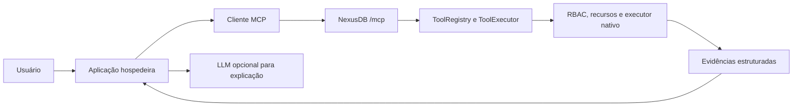

# MCP no NexusDB — manual prático

Edição de 19/10/2026. Adaptação crítica do manual fornecido pelo usuário, conferida contra `src/agent/mcp.rs`, o registro nativo de ferramentas e os exemplos locais. O texto recebido é material de referência; suas propostas de ações autônomas não são instruções executadas por este manual.

## 1. O que MCP resolve

MCP padroniza a descoberta e a chamada de capacidades entre uma aplicação cliente e um servidor. A aplicação que hospeda a experiência de IA mantém o relacionamento com o usuário e com o modelo; o servidor oferece operações com contratos definidos. Uma chamada de ferramenta usa nome e argumentos estruturados, não uma conversa livre com um “gerenciador universal”. Veja a [arquitetura oficial](https://modelcontextprotocol.io/specification/2025-11-25/architecture).

No NexusDB, isso permite que aplicações diferentes descubram ferramentas de grafo e as usem sem conhecer todos os endpoints internos. A autorização e os cálculos continuam no banco. MCP não substitui o armazenamento, o runtime de algoritmos nem o controle de acesso.



A aplicação pode funcionar sem LLM: descoberta, chamadas e testes são operações de protocolo. Quando há um modelo, a aplicação pode usá-lo para propor uma ferramenta, mas precisa validar a proposta. Nos exemplos deste manual, o plano é explícito e a LLM opcional apenas explica resultados.

## 2. Ajustes importantes em relação ao manual original

| Afirmação ou ideia do texto recebido | Formulação adequada ao NexusDB |
|---|---|
| O servidor MCP recebe linguagem natural e coordena tudo | O cliente envia JSON-RPC; a interpretação da pergunta pertence à aplicação/modelo |
| MCP funciona sempre por HTTP com SSE | Existem stdio e Streamable HTTP; o NexusDB nativo responde JSON ao POST |
| Qualquer servidor possui tools, resources e prompts | São capacidades distintas; este servidor nativo anuncia tools |
| Conectar elimina o trabalho de integração | Schemas, autenticação, versões e limites ainda precisam ser tratados |
| Usar MCP evita alucinações | Dados e ferramentas ajudam a ancorar respostas, mas o modelo ainda pode errar |
| Um prompt com regras garante proteção contra injection | Prompt é uma camada auxiliar; permissões e validações precisam existir fora do modelo |
| Publicar o servidor torna operações automaticamente seguras | O catálogo limita descoberta; RBAC e executor decidem o acesso efetivo |
| Autonomia financeira/destrutiva é evolução inevitável | O MCP nativo atual é de leitura e não publica essas ações |
| APIs serão substituídas por MCP | APIs nativas, gateway e MCP coexistem com objetivos diferentes |

Foram retiradas previsões de mercado, percentuais sem medição e descrições de vulnerabilidades de terceiros sem uma fonte verificável. Elas não são necessárias para ensinar o contrato do NexusDB.

## 3. Conceitos do protocolo e capacidades locais

O protocolo define ferramentas, recursos e prompts como primitivas diferentes. Ferramentas têm nomes e schemas; a aplicação descobre e invoca as disponíveis. A especificação não obriga um servidor a oferecer todas as primitivas. [Ferramentas na especificação](https://modelcontextprotocol.io/specification/2025-11-25/server/tools).

| Recurso | NexusDB desta edição |
|---|---|
| `initialize`, `ping` | Implementados |
| `tools/list`, `tools/call` | Implementados |
| `resources/list`, recursos genéricos | Não anunciados pelo MCP nativo |
| `prompts/list`, templates de servidor | Não anunciados pelo MCP nativo |
| Escrita, Cypher arbitrário e pagamentos | Não publicados como ferramentas nativas |
| Sessões HTTP | Vinculadas a usuário, banco e versão |
| Cancelamento | Cooperativo, sujeito aos pontos de checagem do executor |
| Geração de embeddings e respostas | Responsabilidade externa ao MCP nativo |
| OAuth de clientes comerciais | Não implementado pelo mecanismo privado de cabeçalhos atual |

A palavra “completo” não deve ser usada para sugerir que esse subconjunto implementa toda extensão ou todo transporte do ecossistema. O objetivo é descrever um caminho funcional e verificável.

## 4. Transportes: stdio e HTTP

Na revisão de protocolo usada como referência, stdio troca mensagens pelo processo filho. Streamable HTTP envia mensagens JSON-RPC por POST e admite respostas JSON ou streams SSE; um servidor sem stream por GET pode responder 405. HTTP+SSE legado de 2024 é outro transporte. [Contrato oficial de transportes](https://modelcontextprotocol.io/specification/2025-11-25/basic/transports).

O NexusDB nativo utiliza `/mcp` no listener do banco, recebe POST e devolve JSON. GET retorna 405; não há stream SSE de notificações nem retomada de streams. O cliente de exemplo aceita apenas esse subconjunto JSON, não é um SDK MCP universal.

Também existe [knowledge_mcp.py](examples/knowledge_mcp.py), um adaptador Python stdio com ferramentas de conhecimento. Ele encaminha procedimentos autorizados por HTTP e não é o mesmo servidor/transportador que `/mcp`. Não coloque mensagens de depuração em stdout de um processo stdio: esse canal pertence ao protocolo.

## 5. Qual interface usar

| Interface | Quando é útil | Autenticação no checkout |
|---|---|---|
| API nativa | Aplicação conhece os contratos de dados e procedimentos | `X-User`, `X-Pass`, `X-Database` |
| Agent API | Chamada HTTP estruturada de uma ferramenta conhecida | Cabeçalhos nativos |
| MCP nativo | Descoberta e ciclo de ferramentas para clientes MCP | Cabeçalhos nativos, sessão e versão |
| Gateway REST | Publicar uma consulta/fatia de dados para consumidores | Chave por endpoint ou Bearer do gateway |
| MCP knowledge stdio | Processo local com ferramentas fixas de conhecimento | Credenciais no ambiente privado do adaptador |

Uma API key do gateway não autentica automaticamente em `/mcp`. O ID de sessão MCP também não substitui senha nem concede READ. Para dados com escopo fino, não publique uma ferramenta de grafo bruto e espere que a LLM filtre propriedades confidenciais: use a política de conhecimento ou um perfil de gateway apropriado.

## 6. Ferramentas existentes

| Nome MCP | Executor interno | Aplicação acadêmica |
|---|---|---|
| `nexus_schema` | `database.schema` | Descobrir os tipos observados no banco |
| `nexus_graph_stats` | `database.stats` | Conferir estrutura e volume de uma carga |
| `nexus_neighbors` | `graph.neighbors` | Investigar relações a um salto |
| `nexus_bfs` | `graph.bfs` | Explorar entidades até uma profundidade |
| `nexus_shortest_path` | `graph.shortest_path` | Mostrar ligação estrutural sem pesos |
| `nexus_pagerank` | `algo.pagerank` | Produzir ranking estrutural |
| `nexus_vector_search` | `vector.search` | Buscar em um índice previamente criado |
| `nexus_spatial_nearby` | `spatial.nearby` | Localizar elementos segundo coordenadas armazenadas |

Descubra o `inputSchema` real em vez de adivinhar argumentos. Índices e nós necessários precisam existir. A ferramenta vetorial não gera embeddings. As unidades espaciais dependem das coordenadas/CRS. PageRank não demonstra relevância científica nem importância de negócio sem interpretação adicional.

BFS e vizinhos são não direcionados nesse wrapper. O menor caminho admite direção conforme seu schema, mas não é Dijkstra ponderado. Campos `truncated` indicam que a exploração entregue ficou parcial. Limite de linhas não equivale a limite de todo o trabalho do algoritmo.

## 7. Configuração e catálogo

MCP é desabilitado por padrão. Configure antes de iniciar um processo que você administra:

```powershell
$env:NEXUSDB_MCP_ENABLED = 'true'
$env:NEXUSDB_MCP_CONFIG = 'E:\nexusdb\mcp-catalog.local.json'
```

Exemplo de catálogo para um banco e uma conta que já existem:

```json
{
  "databases": {
    "EXAMPLE_MCP_ACADEMICO": {
      "users": ["mcp_student"],
      "tools": ["nexus_schema", "nexus_graph_stats", "nexus_neighbors",
                "nexus_bfs", "nexus_shortest_path", "nexus_pagerank"]
    }
  }
}
```

Criar o JSON não cria usuário, banco ou grant. A conta precisa de READ concedido por um administrador. Com catálogo configurado, bancos ausentes não publicam ferramentas; uma lista vazia de usuários não permite ninguém. Mudanças no arquivo exigem reiniciar o processo correspondente.

Para o primeiro estudo, prefira o laboratório isolado da seção 10. Ele prepara tudo sem mudar o serviço instalado, sem compartilhar portas/data roots e sem usar credenciais existentes.

## 8. Ciclo de uma sessão

O cliente começa com POST `/mcp`, `Content-Type: application/json` e `Accept: application/json, text/event-stream`, além dos cabeçalhos de autenticação.

```json
{
  "jsonrpc": "2.0",
  "id": 1,
  "method": "initialize",
  "params": {
    "protocolVersion": "2025-11-25",
    "capabilities": {},
    "clientInfo": {"name": "cliente-academico", "version": "1.0"}
  }
}
```

O servidor negocia uma das revisões aceitas pelo checkout: `2025-11-25`, `2025-06-18` e `2025-03-26`. Isso não é uma afirmação de que sejam as revisões mais recentes de todo o ecossistema.

Conserve `Mcp-Session-Id` da resposta e envie nas chamadas seguintes, junto com `MCP-Protocol-Version`. Envie `notifications/initialized` sem `id`; a resposta aceita é 202 sem corpo. Depois descubra as ferramentas:

```json
{"jsonrpc":"2.0","id":2,"method":"tools/list"}
```

Uma chamada usa um objeto de argumentos:

```json
{
  "jsonrpc":"2.0",
  "id":3,
  "method":"tools/call",
  "params":{"name":"nexus_neighbors","arguments":{"source":123,"limit":10}}
}
```

O número 123 é ilustrativo; use um ID realmente existente. Em sucesso, o envelope contém `content` e `structuredContent`. Confira também `isError`: uma resposta HTTP recebida não comprova sucesso da ferramenta. Erros JSON-RPC, erros HTTP e erros de ferramenta são camadas distintas.

Ao terminar, envie DELETE `/mcp` com credenciais e sessão. Para trocar o banco, inicialize outra sessão. O servidor verifica permissões novamente; revogar READ bloqueia chamadas posteriores mesmo com uma sessão já aberta. A desconexão do socket não equivale a cancelamento do trabalho.

## 9. Exemplo 1 — descobrir uma instalação existente

O programa [01_descobrir.py](examples/mcp-Example/01_descobrir.py) faz somente descoberta e, opcionalmente, estatísticas. Requer MCP habilitado, conta válida e banco acessível.

```powershell
Set-Location E:\nexusdb
python examples/mcp-Example/01_descobrir.py `
  --url http://127.0.0.1:7474 --user SEU_USUARIO `
  --database SEU_BANCO --stats
```

A senha é solicitada sem eco ou lida de `NEXUSDB_PASSWORD`. Não a informe na linha de comando. O programa exibe as capacidades negociadas e os schemas retornados, fecha a sessão e não cria dados.

O [cliente](examples/mcp-Example/client.py) reaproveita o ciclo de vida do cliente já existente, acrescentando bloqueio de redirecionamentos, orçamento de resposta, conferência do ID e erros sem eco de credenciais. Aceita HTTP somente em loopback e exige HTTPS para origem remota.

## 10. Exemplo 2 — grafo acadêmico e testes de segurança

O programa [02_laboratorio.py](examples/mcp-Example/02_laboratorio.py) cria explicitamente um laboratório isolado com **quatro nós e três relações**:

```text
Aluno Ana SIM → Projeto P001 → Laboratório L001 → Equipamento E001
```

```powershell
Set-Location E:\nexusdb
cargo build --bin nexusdb
python examples/mcp-Example/02_laboratorio.py
```

Usa Python padrão, binário compilado, porta livre, banco `EXAMPLE_MCP_ACADEMICO`, usuário READ e senha aleatória. Catálogo, dados e relatório ficam em `target/mcp-academico/run-*`. Encerra somente seu próprio processo; não apaga dados nem altera o serviço instalado.

O teste cobre versão, capabilities, catálogo, schema de entrada, ping, estatísticas, vizinhos, BFS completo e truncado, caminho e PageRank. Também verifica recusa de escrita não publicada, campo extra, método de recursos não anunciado, revogação READ e restauração da permissão.

**Por que usar:** a mesma consulta estruturada pode atender um painel, um agente ou um teste. A recusa permanece no executor, independentemente do que uma LLM diga ao usuário. O caminho é evidência de conexão; não prova que o equipamento causou um atraso nem que uma ação operacional deve ser executada.

O `report.json` conserva verificações, evidências e tempos HTTP sem senhas/sessões. Não interprete esse conjunto pequeno como benchmark de escala.

## 11. Exemplo 3 — explicar dados MCP com sua LLM local

O programa [03_assistente.py](examples/mcp-Example/03_assistente.py) permite três planos explícitos: `caminho`, `vizinhos` e `estatisticas`. Primeiro descobre e executa a ferramenta; só depois oferece o resultado ao modelo.

Sem modelo, para conferir a recuperação:

```powershell
python examples/mcp-Example/03_assistente.py --tarefa caminho
```

Com o Gemma GGUF disponível no seu Jarvis:

```powershell
python examples/mcp-Example/03_assistente.py --tarefa caminho `
  --gguf 'F:\Jarvis\modelos_locais\gemma-3-1b-it-Q4_K_M.gguf' `
  --gguf-python 'F:\WinPython\python\python.exe'
```

O Python habitual faz HTTP; o WinPython carrega os pesos usando `llama-cpp-python`. O worker recebe apenas o prompt/contexto e não herda variáveis de credenciais. Nenhum modelo é baixado e nenhum arquivo do Jarvis é alterado. Há também `--ollama-model` para um modelo já servido localmente.

O modelo não escolhe a ferramenta neste exemplo; `--tarefa` escolhe um plano determinístico. Isso torna a fronteira observável para o estudante. O texto gerado é marcado com `review_required` e não é enviado a nenhum executor de escrita. Verifique nomes, IDs, direções e inferências antes de usá-lo como explicação.

## 12. Onde entram RAG e GraphRAG

MCP é o transporte/contrato de ferramentas; RAG e GraphRAG são estratégias de recuperação e construção de contexto. São dimensões complementares.

O MCP nativo publica `nexus_vector_search`, mas não `graphRAG.retrieve`. Não envie um nome inventado esperando que o servidor descubra o procedimento. Você pode compor busca vetorial e ferramentas de vizinhança no cliente quando tiver um contrato autorizado e tratar truncamento/versões. Chamadas separadas não constituem automaticamente um snapshot único.

Para comparar os caminhos implementados, use os [laboratórios API key/NPL/GraphRAG](examples/academico_api_ia-Example/README.md): eles distinguem recuperação nativa, expansão no cliente e geração opcional. Para conhecimento com ACL/contexto, use o [adaptador stdio](examples/knowledge_mcp.py) e os [contratos knowledge](Docs/KNOWLEDGE_PHRONESIS.md). Para GraphRAG nativo, consulte [vetores e GraphRAG](Docs/VECTOR_HNSW_GRAPHRAG.md).

## 13. Clientes visuais e automação

Uma integração com um orquestrador visual ou aplicativo de chat precisa suportar o transporte HTTP usado e os cabeçalhos privados de autenticação. Não basta colar uma “URL SSE” de outro produto. Configure origem `/mcp`, negociação de versão, sessão e autenticação conforme o cliente concreto permite.

Este manual não promete compatibilidade pronta com n8n, clientes de desktop ou ferramentas comerciais sem teste de suas versões. Uma implantação remota também precisa cuidar de TLS, proxy, origens, revogação e armazenamento de segredos. O NexusDB não oferece OAuth automático apenas por implementar ferramentas MCP.

## 14. Segurança e limites que podem ser testados

- Publique somente as ferramentas necessárias e conceda READ em banco adequado.
- Descoberta não concede acesso: catálogo e RBAC são controles complementares.
- Conteúdo de nós e descrições pode conter instruções maliciosas; trate como dados.
- Uma regra no prompt não substitui validação de argumentos, allowlists e ausência de execução arbitrária.
- Nunca use a resposta da LLM como senha, URL de destino ou programa a executar.
- Revogação bloqueia entregas futuras; não recolhe informações já entregues.
- Banco knowledge scoped pode restringir ferramentas de grafo bruto para usuários comuns.
- Timeouts/cancelamento são cooperativos; reservas estimadas não são um teto rígido de RSS.

O mecanismo atual aplica limites de corpo, taxa, sessões, concorrência e resultados e mantém auditoria MCP no histórico nativo. Detalhes e defaults operacionais estão em [NATIVE_MCP.md](Docs/NATIVE_MCP.md). Não aumente limites apenas para ocultar um teste que revela trabalho excessivo.

## 15. Exercícios e diagnóstico

| Exercício | Resultado que deve ser inspecionado |
|---|---|
| Reduzir limite de BFS para dois nós | `truncated=true`, sem afirmar contexto completo |
| Revogar READ após initialize | Sessão não permite continuar lendo |
| Chamar uma escrita não publicada | Erro; nenhuma mutação |
| Pedir um método resources ausente | Erro de protocolo, não um recurso vazio fictício |
| Explicar o caminho por LLM | IDs corretos e ausência de causalidade inventada |
| Alterar catálogo e reiniciar laboratório | Descoberta corresponde à nova publicação |

HTTP 401 sugere credencial; 403 sugere autorização/origem/política; 405 em GET pode ser o comportamento esperado sem SSE. Falha de ferramenta vem em `isError`; ela não representa necessariamente falha do transporte. Resultado vazio não é sinônimo de acesso negado.

Para uma avaliação acadêmica, registre sucesso de chamadas, recusas corretas, truncamento, fidelidade da explicação, citações e duração por etapa. Separe teste funcional de medição de desempenho. Não declare redução de alucinação apenas porque a aplicação passou a usar MCP.

## 16. Fontes e estado da validação

Fontes locais: [implementação MCP](src/agent/mcp.rs), [registro de ferramentas](Docs/TOOL_REGISTRY.md), [contrato nativo](Docs/NATIVE_MCP.md), [demo hospitalar existente](examples/native_mcp_demo.py) e [laboratórios deste manual](examples/mcp-Example/README.md).

As referências externas citam a revisão de especificação compatível com o checkout. O protocolo pode evoluir; o manual descreve o subconjunto conferido nesta edição. O [relatório de validação](examples/mcp-Example/VALIDACAO.md) registra o que foi efetivamente executado, separando geração por LLM de recuperação sem modelo.
