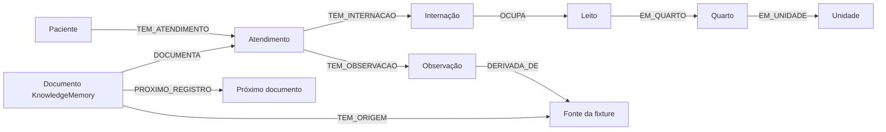

# Hospital longitudinal sintético com NexusDB

**Versão com MCP nativo:** [tutorial e comandos](README_MCP.md), implementada em
`demo_mcp.py`. Recupera evidências por BFS usando `tools/call`, com Gemma local
opcional, em banco isolado contendo somente P001.

**Validado:** 21 verificações integradas no NexusDB real e nove testes unitários passaram. [Evidências da execução](VALIDACAO.md).

Exemplo acadêmico executável inspirado na organização metodológica de **Park, Chen e Dettmers, “Synthetic Hospital: An Open, Verifiable, Physician-Validated Longitudinal EHR Benchmark”, arXiv:2609.30027v1**. [Artigo](https://arxiv.org/abs/2609.30027).

O uso ilustrado aqui é o NexusDB como camada de persistência, histórico, autorização e recuperação de evidências de um hospital **inteiramente fictício**. O artigo não avalia nem recomenda o NexusDB. Não copiamos seus pacientes, corpus, ontologias ou resultados; reutilizamos a ideia de separar fatos estruturados, documentação e gabarito antes da geração de linguagem.

## 1. O que este exemplo demonstra

- Identidades estáveis: **20 pacientes e três atendimentos por paciente**.
- Grafo com internações, leitos, quartos, unidade, observações e fontes.
- Sessenta documentos persistidos como memórias nativas do NexusDB.
- Vinte perguntas de recuperação com fontes e IDs de fatos esperados.
- Isolamento de pacientes por contexto e ACL, antes da busca/ranking.
- Busca lexical e recuperação híbrida com vetor exato e PPR nativos.
- Correção retroativa: comparação de informação atual e conhecida no watermark anterior.
- Resposta com citações, abstenção sem evidência e avaliação de fontes/omissões.
- Geração GGUF opcional, sem entregar o arquivo de gabarito à LLM.

O cenário é **operacional**, sem diagnósticos ou recomendação de tratamento. Um requisito `RECURSO_A` ou `RECURSO_B` é um dado explícito da fixture, não uma indicação clínica inferida. Leito indisponível durante higienização é uma regra didática, não um modelo validado de gestão hospitalar real.

## 2. Preparar e executar

Requisitos: Python 3.10+ com biblioteca padrão e o NexusDB compilado com a feature `knowledge`.

```powershell
Set-Location E:\nexusdb
cargo build --features knowledge --bin nexusdb
python examples/hospital_longitudinal-Example/demo.py --create-lab
```

`--create-lab` é uma autorização explícita para criar **um servidor e um banco de teste próprios**. O programa não conecta ao serviço instalado. Usa porta livre, credenciais aleatórias, CPU e diretório novo; encerra somente seu processo. O banco chama-se `EXAMPLE_HOSPITAL_LONGITUDINAL` dentro dessa instância isolada.

Não é preciso instalar requests, Streamlit, modelos de embeddings ou um servidor de LLM. Para gerar só os arquivos de estudo, sem abrir o banco:

```powershell
python examples/hospital_longitudinal-Example/demo.py --generate-only
```

Os modos são mutuamente exclusivos e um deles é obrigatório. Saída e executável podem ser escolhidos:

```powershell
python examples/hospital_longitudinal-Example/demo.py --create-lab `
  --server E:\nexusdb\target\debug\nexusdb.exe `
  --output E:\nexusDB-tests\hospital-longitudinal --seed 42
```

Se `knowledge.initialize` for indisponível, confira a feature do executável fornecido. Não use um binário sem knowledge esperando que o script simule a API.

## 3. Modelo de dados



Antes da correção, são **406 nós e 605 relações**:

| Entidade | Quantidade |
|---|---:|
| Paciente | 20 |
| Atendimento | 60 |
| Internação | 60 |
| Leito | 20 |
| Quarto | 5 |
| Unidade | 1 |
| Observação | 120 |
| Fonte | 60 |
| Documento KnowledgeMemory | 60 |

Cada paciente usa um leito fictício nos seus três episódios separados. Esse desenho simples permite verificar integridade sem simular competição complexa por capacidade. As regras conferem ausência de sobreposição e reutilização somente após o término da higienização.

As 120 observações são duas por atendimento: requisito operacional e fim de higienização. Cada fonte registra versão do gerador, semente, versão e estado de validação **da regra sintética**, não validação clínica. Não há código ICD/SNOMED/LOINC ficticiamente apresentado como homologado.

## 4. Fatos, narrativa e gabarito

`dataset.py` constrói primeiro entidades, relações, horários e IDs dos fatos. O documento é um template desses fatos, sem LLM. O gabarito nasce da estrutura conhecida, nunca da avaliação de uma narrativa gerada.

```text
Regras/seed → fatos e horários → grafo + documentos → consulta NexusDB → evidências
                    └→ gabarito local do avaliador                └→ resposta/LLM
```

O arquivo `ground_truth.evaluator.json` **não é enviado ao NexusDB nem ao modelo**. Ele contém as fontes esperadas, os seis IDs de fatos por paciente e a referência de versões da tarefa de correção. Fica separado de `fixture.json`.

Há splits fixos por paciente: 12 train, quatro validation e quatro test. Cada encontro tem fonte exclusiva; nenhuma fonte é compartilhada entre pacientes/splits. Esses nomes servem à organização de uma avaliação: o programa não treina modelo nem seleciona parâmetros usando o conjunto test. Métricas de todos os splits são mostradas separadamente no relatório.

## 5. Consultas e autorização reais

As chamadas usam `POST /db/data/cypher`, `include_statement_results=true` e parâmetros estruturados. Uma busca tem esta forma:

```json
{
  "include_statement_results": true,
  "statements": [{
    "query": "CALL knowledge.search($request)",
    "parameters": {"request": {
      "query": "P001",
      "top_k": 3,
      "context": {"scope": "project", "scope_id": "P001"}
    }}
  }]
}
```

A demonstração usa `project` como mecanismo técnico de particionamento de contexto, com um ID por paciente. Isso não cria uma nova política clínica ou um recurso FHIR. O administrador cria as memórias; `reader_a` recebe READ no banco e é leitor autorizado dos documentos P001. `reader_b` recebe os documentos P002. Os demais pacientes ficam disponíveis ao avaliador administrador.

Trocar `scope_id` de P001 para P002 não concede acesso: a ACL `readers` também precisa permitir a conta. Após `knowledge.initialize`, a API bruta de nós é recusada para os leitores comuns. O script testa tanto a tentativa de acesso cruzado como a API bruta e a revogação final de READ.

O administrador continua sendo um operador confiável com acesso aos fatos estruturados do banco inteiro. Não entregue suas credenciais à aplicação do usuário. O MCP bruto do grafo não oferece filtragem automática por paciente; este exemplo usa os procedimentos scoped de conhecimento.

## 6. Recuperação e avaliação

O avaliador faz vinte consultas de recuperação usando o código do paciente. É uma tarefa controlada de busca de registros; obter 100% nela não mede compreensão de perguntas clínicas ou generalização semântica.

Para cada paciente, `report.json` conserva:

- Precision@3: quantas das três posições são fontes relevantes;
- Recall@3: fração das três fontes esperadas recuperadas;
- nDCG@3 com relevância binária;
- cobertura dos seis IDs de fatos;
- IDs de fatos de outro paciente ou fora do gabarito.

As três fontes são igualmente relevantes nessa fixture. Portanto nDCG não testa preferência entre níveis de relevância. A cobertura de IDs confirma presença dos marcadores, **não valida semanticamente cada valor clínico ou cada frase**.

`knowledge.hybridSearch` combina BM25, busca vetorial exata e PPR sobre os documentos autorizados. As relações `PROXIMO_REGISTRO` ligam a trajetória do paciente. Os vetores de três dimensões são definidos manualmente para isolar o funcionamento do contrato; não são embeddings de linguagem nem benchmark HNSW.

Também são testados contexto com orçamento insuficiente e pergunta sem suporte. A resposta vazia é transformada em `insufficient_evidence`, sem inventar um fato. O template de resposta usa apenas trechos retornados e cita `source_id@version`.

## 7. Correção e dois tempos

No terceiro atendimento de P001, o avaliador registra o watermark real do journal. Depois aplica uma correção sintética de mais trinta minutos no fim da higienização:

1. Atualiza a observação estruturada e a internação.
2. Acrescenta uma fonte v2, preservando a fonte v1.
3. Usa `memory.supersede` com revisão esperada para publicar o documento corrigido.
4. Liga o novo documento ao atendimento, fonte v2 e trajetória.
5. Compara a consulta atual com a consulta que inclui `projection.system_at` anterior.

A consulta atual deve devolver v2 e o horário corrigido. A consulta histórica deve conservar v1 e o horário original. As versões possuem IDs nativos distintos e o mesmo identificador lógico de origem, com versão explícita.

Essas operações são sequenciais e **não formam uma transação coletiva** entre módulos. O laboratório não executa leituras concorrentes durante a correção. Não o apresente como garantia de atomicidade para um sistema hospitalar multiusuário. Uma aplicação real precisaria de um contrato de publicação consistente para esse fluxo.

Os horários são UTC e pertencem à fixture. A referência `system_at` é obtida do banco. O cenário mostra correção retrospectiva, não previsão de alta ou de permanência e não uma ação sobre um leito real.

## 8. Geração opcional pela LLM local

Para os arquivos GGUF já existentes no Jarvis:

```powershell
python examples/hospital_longitudinal-Example/demo.py --create-lab `
  --gguf 'F:\Jarvis\modelos_locais\gemma-3-1b-it-Q4_K_M.gguf' `
  --gguf-python 'F:\WinPython\python\python.exe'
```

O Python habitual consulta o banco; o worker WinPython carrega o GGUF. Ele recebe somente as evidências atuais autorizadas de P001 e o prompt, sem arquivo de gabarito nem credenciais herdadas. Não há download de modelos nem execução de comandos produzidos pela LLM.

A geração opcional usa o contexto que já foi entregue antes do teste de revogação. Revogar READ impede novas consultas; não apaga do cliente dados anteriormente recebidos. Os arquivos locais do avaliador também não são uma interface de acesso para leitores comuns.

O texto fica em `generation.answer`. O relatório apresenta citações ausentes/obsoletas, IDs de fatos omitidos e IDs inesperados. Essa análise é sintática e não homologa exatidão factual ou segurança clínica. O campo `factual_accuracy_validated` permanece falso e a resposta requer revisão.

Sem `--gguf`, o programa não afirma uso de LLM. A validação padrão separa recuperação determinística da geração, como recomendado pela metodologia de gabarito independente.

## 9. Arquivos e inspeção

Cada execução cria `target/hospital-longitudinal/run-*`:

| Arquivo | Conteúdo |
|---|---|
| `fixture.json` | Regras materializadas, IDs de negócio, horários e documentos sintéticos |
| `ground_truth.evaluator.json` | Referência privada do avaliador; não publicada ao banco/modelo |
| `report.json` | Verificações, recuperação, citações, correção histórica e limitações |
| `data/` | Banco isolado com journal e persistência reais |
| `server.log` | Diagnóstico do processo criado |

Os artefatos são locais do operador; não publique a pasta inteira como se fosse uma resposta autorizada a um leitor. O arquivo de fixture é o estado original v1; a correção aplicada e sua evidência ficam explicitadas no relatório, sem reescrever a entrada original.

## 10. Testes e exercícios

```powershell
python -m unittest discover -s examples/hospital_longitudinal-Example -p test_dataset.py -v
python examples/hospital_longitudinal-Example/demo.py --create-lab
```

Os testes unitários exercitam reprodutibilidade, volumetria, relações sem endpoint, datas inválidas, sobreposição, avaliação de evidência errada, citações obsoletas e abstenção. O teste integrado usa HTTP, ACL e persistência reais. Veja [resultados registrados](VALIDACAO.md).

Exercícios sugeridos:

1. Troque a semente e compare horários e hashes, sem mudar a identidade dos pacientes.
2. Introduza uma relação sem destino na fixture e confira a rejeição antes da carga.
3. Compare as respostas v1/v2, suas fontes e o watermark.
4. Revise os fatos que uma LLM pequena omitiu, em vez de avaliar apenas fluência.
5. Amplie as perguntas com relevância graduada e fontes distratoras antes de comparar técnicas de recuperação.

## 11. Relação com o artigo e próximos passos

O artigo inspira **fatos primeiro, proveniência, longitudinalidade e gabarito independente**. O piloto não reproduz seus pacientes, ontologias, revisão por médicos, tarefas diagnósticas ou métricas de gravidade. Seus resultados não são transferíveis a este corpus ou aos modelos GGUF locais.

A geração não é epidemiologicamente calibrada e não serve para dimensionar um hospital real. Dados ausentes, contradições e erros documentais poderiam ser acrescentados como extensões controladas; não são apresentados como problemas já resolvidos pelo artigo ou por este piloto.

O próximo passo de pesquisa seria variar dificuldade, introduzir distratores e medir respostas com revisão especializada. Para interoperabilidade FHIR, terminologias médicas, uso clínico ou operação concorrente, seriam necessárias implementações e validações específicas.

Referência bibliográfica: PARK, Christine; CHEN, Valerie; DETTMERS, Tim. *Synthetic Hospital: An Open, Verifiable, Physician-Validated Longitudinal EHR Benchmark*. Preprint, arXiv:2609.30027v1, 2026. [Disponível no arXiv](https://arxiv.org/abs/2609.30027). Ver também a [análise de adaptação ao NexusDB](../leitos_hospitais-Example/PROPOSTA_SYNTHETIC_HOSPITAL.md).
